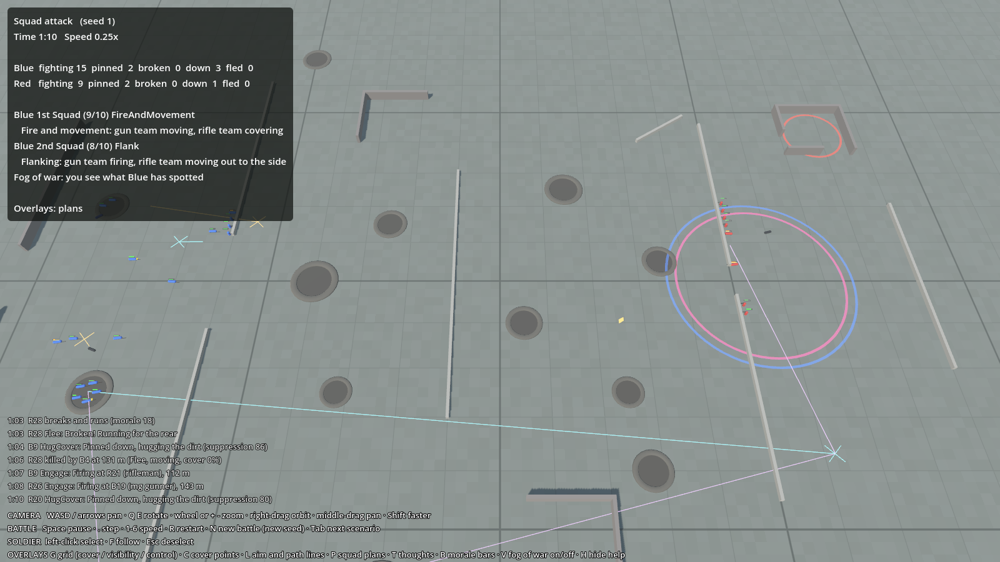

# Ground War

An RTS where you never control soldiers directly. You give orders; AI commanders plan, and AI soldiers fight.
This repository is the **prototype**: simple shapes and placeholder models until the AI is fun to watch.

Design docs: [Design document](https://claude.ai/artifact/Q1UHZQmTfqk9WJ5CzV6YGs) ·
[How the AI works](https://claude.ai/artifact/HHYXkduRrMJMCjKFVfnkoz) ·
[Build plan](https://claude.ai/artifact/RZdiTzT1fSPFsojRV7ECAe)

## Where we are

| Milestone | State |
|---|---|
| 1. Test range: map, battlefield grid, cover points, free camera, overlays | done |
| 2. Soldiers that fight: take cover, shoot, get suppressed, break and run | done |
| 3. Squads with tactics and fog of war | done |
| 4. Messages and delay | done |
| 5. Company commander: plans, brief-back, refusing death traps | done |
| 6. Spectacle: sounds, smoke, map table, battle cam, replays, after-action report | done |
| 7. Battalion, part 1: mortars, smoke screens, commanders calling for fire, MG sections | done |
| 7. Battalion, part 2: several companies, enemy battalion commander, destroy the HQ to win, reinforcements | next |
| 8. Tank platoons with crew AI | |



## One-time setup

1. **Godot 4.7, .NET edition.** From [godotengine.org/download](https://godotengine.org/download), pick the version labelled **.NET** (it runs C#). Unzip it anywhere.
2. **.NET SDK 8** (or newer) from [dotnet.microsoft.com/download](https://dotnet.microsoft.com/download).
3. **Clone this repository** with GitHub Desktop (File → Clone repository → `GroundWar`).

## Play it

1. Start Godot. In the Project Manager click **Import**, browse to the cloned folder and pick `project.godot`, then **Import & Edit**.
2. Press **F5** (or the ▶ button top right). The first time, Godot builds the code, which takes a few seconds.
3. Watch the battle. **Tab** switches between the scenarios:
   - **Squad attack** (starts first): Blue 1st Squad sets up in the middle and pins Red down while Blue 2nd Squad closes in, then its gun team fires and its rifle team goes round the side and assaults. Red has a hidden machine-gun post in the north-east ruin.
   - **Firefight at the wall**: one Blue squad attacks alone. It usually fails, which is the point: compare it with the two-squad attack.
   - **Meeting engagement**: two equal squads advance into the middle. The map is the same from both ends, so each side wins about as often as the other.
   - **Town attack**: street fighting. Two Blue squads fight through houses, yards and rubble to take a crossroads held by a Red squad, with a Red machine gun further down the main street. Lots of cover, short ranges; the defender usually holds.
   - **Tank support**: the first tank. The same attack as the firefight at the wall, but a Blue tank leads the squad in with its main gun and machine gun. Red has an anti-tank rifle in the squad (it can only break a track) and a two-man bazooka team off to the north, placed to hit the tank's side armour. Rifles and machine guns just ring off the armour. With the tank Blue usually wins; without it Blue usually loses. Click the tank to see its armour, shells and what its commander is thinking.
   - **Orders under fire** (milestone 4): the squad attack again, but every order comes from Blue HQ (the tent at the west edge) and takes time. The 1st Squad has a telephone line; the 2nd Squad's orders go by runner. Reports come back the same way, and you only see the enemy as those reports reach HQ. Click one of your soldiers to give his squad orders from the order panel.
   - **Farmhouse** (milestone 5): one company a side. Battalion HQ orders A Company to take a walled farmhouse. Captain Hale weighs up a frontal assault against pinning the farm with one squad while the others go round a flank, and sends you his plan (the brief-back panel at the top). Press **Enter** to approve, **Backspace** to reject, or do nothing and he goes ahead after 10 s. His plan is drawn as arrows on the map. If he thinks an order is a death trap he refuses and says why; send it again to insist. See [docs/systems/company-commander.md](docs/systems/company-commander.md).
   - **Stress test**: 1,000 soldiers a side on a big field, to check the game stays smooth at battalion size. Zoom out to see it all.

To get a new version: in GitHub Desktop press **Fetch origin**, then **Pull**, then press F5 in Godot again.
To try a pull request before it is merged: in GitHub Desktop pick its branch from **Current branch**.

### Controls

| | |
|---|---|
| **Camera** | WASD or arrows pan · Q / E rotate · mouse wheel or + / − zoom · right-drag orbit · middle-drag pan · Shift faster |
| **Battle** | Space pause · `.` step one tick · 1–6 speed (¼× to 8×) · R restart · N new battle (different dice) · Tab next scenario |
| **Soldier** | Left-click a soldier to see what he's thinking · F follow him · Esc deselect |
| **Orders** | With one of your soldiers selected (in a scenario with an HQ): press Advance, Attack, Suppress or Hold, then click the map; Halt and Fall back go at once. Esc cancels. A man in a company: the order goes to his company commander |
| **Company** | Enter approve the brief-back · Backspace reject it |
| **Support** | Select a man of a mortar section: Fire HE or Fire smoke, then click the target · select a man of an MG section: Attach to a company, then click any man of that company (Back to battalion takes it out again) |
| **Watch** | J battle cam (follows the hottest fighting) · Z map table · O after-action report · M mute · Shift+R replay the battle with your orders · [ back 30 s · ] on 30 s |
| **Overlays** | G battlefield grid (cover → visibility → control → off) · C cover points · L aim and path lines · P squad plans · T every soldier's thoughts · B morale bars · V fog of war on/off · H hide help |

**Reading a soldier.** Blue and red uniforms are the two sides; he stands, kneels or lies down to match his stance; a yellow
disc on the helmet marks the sergeant. The bar above him: top = morale (green steady, yellow shaken, orange pinned, red broken),
bottom = suppression (yellow fills as bullets pass close). Dark men lying down are wounded; dark grey men on their backs are dead.

**Reading a tank.** The tank is painted in its side's colour; its turret turns on its own to where the commander is aiming. A knocked-out tank goes dark with
its turret twisted. Shells show as a bright tracer, a flash and a puff of smoke where they burst. The tank commander drives in
short bounds, stops to fire the main gun, turns his front armour toward anti-tank weapons, and hangs back if his infantry falls
too far behind. Anti-tank rifles can't get through a medium tank's armour, only break a track; a bazooka gets through
the side or rear inside about 100 m, and its backblast gives the gunner away. See [docs/systems/tanks.md](docs/systems/tanks.md).

**Squads.** Each squad splits into a gun team (around the machine gun) and a rifle team. The squad leader picks a tactic:
travel, bounding overwatch (one team moves, the other covers), fire and movement, flank, assault, suppress, defend, or fall back.
The top-left panel shows each Blue squad's tactic and what it is doing. With **P** on, orange lines show where the gun team is going,
cyan lines the rifle team, and purple the flanking route.

**The log (bottom left)** lists what a commander would hear about: casualties, men breaking or rallying, squads changing
tactic. Each soldier's every change of mind is left out, except for the soldier you have selected. With fog of war on,
Red's own decisions are hidden.

**Who wins.** A side that can no longer fight loses. Otherwise, when the fighting dies down or time runs out, the side holding
its objective wins (the one with more men on it, if both got there). If nobody holds one and only one side was attacking, the
defender wins. If both sides attacked, the side with clearly more men still fighting wins (20 points more); otherwise it's a draw.

**Fog of war (V).** You see the battle as Blue does. Red soldiers only appear while Blue can see them; red discs mark where
an enemy was last seen (fading as the sighting gets older; a big disc is a guess from a muzzle flash). Each squad only knows what its
own men have seen, or what a squad close by tells it. Press V to see everything.

**Foxholes.** A squad told to hold digs in when things are quiet: each man digs his own foxhole (about 90 seconds),
shown as a dark hole with a ring of earth. A foxhole protects from every side, better than a crater.

**Cover points (C).** Green = low wall, yellow = crater, cyan = corner of a ruin you can shoot from,
blue = hiding spot behind a ruin, orange = someone has claimed it. Bars point at the side they protect from.

## How it all works

Every system (soldier AI, squads, morale, fog of war, maps, results, drawing, testing tools) is written up in plain
words in [docs/](docs/README.md): what it does, how it works, why, where the code is, and how to tune and test it.

## Change how battles feel

All tuning numbers live in plain text files in `data/`. Edit one in any text editor, save, and press **R** in the game.

- `data/rules.json`: spotting, cover, morale and suppression thresholds, how long men stay in a spot before the next rush.
- `data/weapons.json`: accuracy by range, rate of fire, how frightening each weapon is, and armour penetration.
- `data/vehicles.json`: the tank's speed, armour, guns, and the chances when a shot gets through.
- `data/maps/test_range.json`: walls and craters (positions in metres).
- `data/scenarios/*.json`: who fights, how many, with what orders.

## Change how units look

Soldiers and tanks are 3D models in `models/` (`soldier.glb`, `tank.glb`). To look at them on their own, open
`game/ModelViewer.tscn` in Godot and press **F6**. To use your own models, follow [docs/models.md](docs/models.md):
export from Blender as `.glb` over the old file, name team-coloured materials "Team", and name the soldier's poses
Standing, Crouched, Prone and Dead and the tank's turret "Turret".

## How the code is laid out

| Folder | What it is |
|---|---|
| `sim/GroundWar.Sim` | The battle simulation, plain C# with no Godot code, so it can be tested without a screen and moved to Unreal later. |
| `sim/GroundWar.Sim.Tests` | Automated tests. |
| `sim/GroundWar.Runner` | Plays battles with no screen and prints results, for checking the AI quickly. |
| `game/` | The Godot side: drawing, camera, input, overlays. |
| `data/` | Tuning, maps and scenarios. |
| `models/` | 3D models for soldiers and tanks (`.glb`). Replace them with your own: see [docs/models.md](docs/models.md). |
| `sounds/` | Placeholder battle sounds (`.wav`), made by `tools/make_sounds.py`. Replace them with real recordings of the same name. |
| `tools/` | Scripts that generate content: the maps, the placeholder models and sounds. |

For developers (no Godot needed):

```
dotnet test sim/GroundWar.Sim.Tests
dotnet run --project sim/GroundWar.Runner -- --battles 30                   # results table
dotnet run --project sim/GroundWar.Runner -- --battles 1 --seed 4 --log     # every decision in one battle
dotnet run -c Release --project sim/GroundWar.Runner -- --scenario scenarios/meeting.json --map maps/meeting_field_c.json --battles 300   # same scenario, other ground
dotnet run -c Release --project sim/GroundWar.Runner -- --scenario scenarios/stress_1000.json --battles 1 --profile   # 1,000 a side, timing
```
