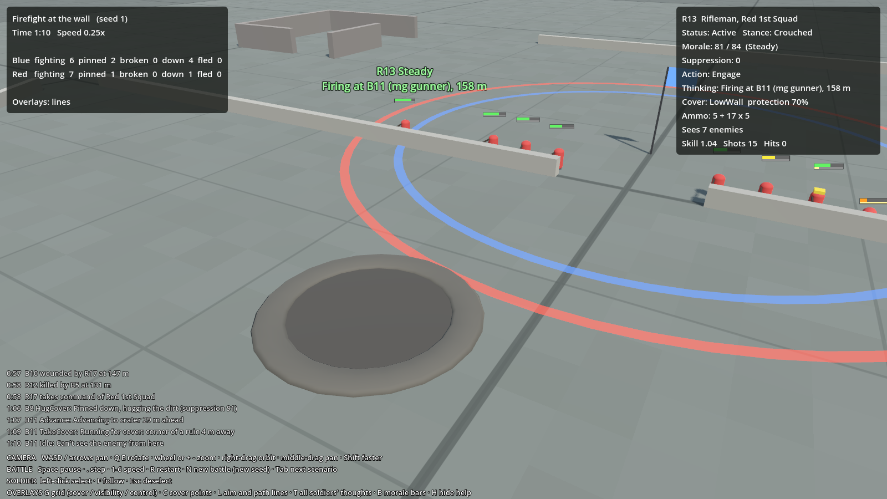

# Ground War

An RTS where you never control soldiers directly. You give orders; AI commanders plan, and AI soldiers fight.
This repository is the **prototype**: grey boxes and simple shapes until the AI is fun to watch.

Design docs: [Design document](https://claude.ai/artifact/Q1UHZQmTfqk9WJ5CzV6YGs) ·
[How the AI works](https://claude.ai/artifact/HHYXkduRrMJMCjKFVfnkoz) ·
[Build plan](https://claude.ai/artifact/RZdiTzT1fSPFsojRV7ECAe)

## Where we are

| Milestone | State |
|---|---|
| 1. Test range: map, battlefield grid, cover points, free camera, overlays | done |
| 2. Soldiers that fight: take cover, shoot, get suppressed, break and run | done |
| 3. Squads with tactics and fog of war | next |



## One-time setup

1. **Godot 4.7, .NET edition.** From [godotengine.org/download](https://godotengine.org/download), pick the version labelled **.NET** (it runs C#). Unzip it anywhere.
2. **.NET SDK 8** (or newer) from [dotnet.microsoft.com/download](https://dotnet.microsoft.com/download).
3. **Clone this repository** with GitHub Desktop (File → Clone repository → `GroundWar`).

## Play it

1. Start Godot. In the Project Manager click **Import**, browse to the cloned folder and pick `project.godot`, then **Import & Edit**.
2. Press **F5** (or the ▶ button top right). The first time, Godot builds the code, which takes a few seconds.
3. Watch the battle. Blue's reinforced squad (12 men, 2 machine guns) attacks Red's squad (9 men, 1 machine gun) holding a stone wall.

To get a new version: in GitHub Desktop press **Fetch origin**, then **Pull**, then press F5 in Godot again.
To try a pull request before it is merged: in GitHub Desktop pick its branch from **Current branch**.

### Controls

| | |
|---|---|
| **Camera** | WASD or arrows pan · Q / E rotate · mouse wheel or + / − zoom · right-drag orbit · middle-drag pan · Shift faster |
| **Battle** | Space pause · `.` step one tick · 1–6 speed (¼× to 8×) · R restart · N new battle (different dice) · Tab next scenario |
| **Soldier** | Left-click a soldier to see what he's thinking · F follow him · Esc deselect |
| **Overlays** | G battlefield grid (cover → visibility → control → off) · C cover points · L aim and path lines · T every soldier's thoughts · B morale bars · H hide help |

**Reading a soldier.** Blue and red capsules are the two sides; the stick shows where he faces; a yellow cap marks
the sergeant. The bar above him: top = morale (green steady, yellow shaken, orange pinned, red broken),
bottom = suppression (yellow fills as bullets pass close). Dark lying shapes are wounded, grey are dead.

**Cover points (C).** Green = low wall, yellow = crater, cyan = corner of a ruin you can shoot from,
blue = hiding spot behind a ruin, orange = someone has claimed it. Bars point at the side they protect from.

## Change how battles feel

All tuning numbers live in plain text files in `data/`. Edit one in any text editor, save, and press **R** in the game.

- `data/rules.json`: spotting, cover, morale and suppression thresholds, how long men stay in a spot before the next rush.
- `data/weapons.json`: accuracy by range, rate of fire, how frightening each weapon is.
- `data/maps/test_range.json`: walls and craters (positions in metres).
- `data/scenarios/*.json`: who fights, how many, with what orders.

## How the code is laid out

| Folder | What it is |
|---|---|
| `sim/GroundWar.Sim` | The battle simulation, plain C# with no Godot code, so it can be tested without a screen and moved to Unreal later. |
| `sim/GroundWar.Sim.Tests` | Automated tests. |
| `sim/GroundWar.Runner` | Plays battles with no screen and prints results, for checking the AI quickly. |
| `game/` | The Godot side: drawing, camera, input, overlays. |
| `data/` | Tuning, maps and scenarios. |

For developers (no Godot needed):

```
dotnet test sim/GroundWar.Sim.Tests
dotnet run --project sim/GroundWar.Runner -- --battles 30                   # results table
dotnet run --project sim/GroundWar.Runner -- --battles 1 --seed 4 --log     # every decision in one battle
```
