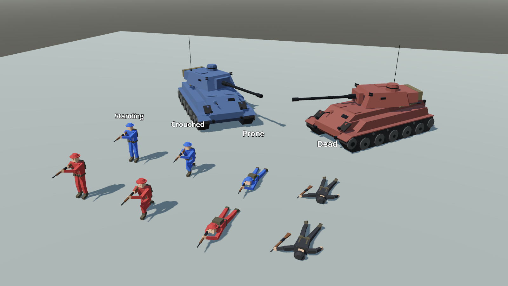

# Unit models: how they are made and how to swap in your own

The soldiers and tanks you see in the game are 3D models in the `models/` folder. This page explains where they
come from, how the game uses them, and how to replace them with your own.

## What's there now

| File | What it is | Made by |
|---|---|---|
| `models/soldier.glb` | A WW2-style rifleman in four poses: **Standing**, **Crouched** (kneeling), **Prone** (lying, rifle forward), **Dead** (on his back, rifle dropped). About 440 triangles each. | `tools/make_models.py` |
| `models/tank.glb` | A medium tank: hull with tracks and five road wheels a side, bow machine gun, a **Turret** that turns (cupola, hatches, aerial, stowage bin) and a **Gun** with a muzzle brake and coaxial machine gun. About 1,900 triangles. | `tools/make_models.py` |

They are placeholders: simple, low-poly, flat-shaded and built entirely from boxes and cylinders by a script, so
they can be remade any time. They are meant to be replaced by hand-made models later.

To regenerate them after changing the script: `python3 tools/make_models.py` (needs only Python 3, no Blender).

## Checking models without a battle

Open `game/ModelViewer.tscn` in Godot and press **F6** (run current scene). It shows every soldier pose and the tank
in both sides' colours with the battlefield lighting. Mouse wheel zooms, left/right arrows turn the view, Space
stops the turrets turning. Use it whenever you change a model.

## How the game uses them

- **Soldiers** (`game/SoldierCrowd.cs`): a battalion is up to 2,000 men, so the game doesn't make a separate object
  for each one. Each pose is drawn for the whole battle in one batch (Godot's MultiMesh); every frame each soldier is put
  into the batch for his current pose and hidden in the others. Standing, crouched and prone follow the soldier's
  stance; wounded men use the Prone pose; dead men use Dead. Sergeants get a yellow disc on top of the helmet.
- **Team colour** (`game/shaders/team_paint.gdshader`): every material whose name contains **Team** is multiplied by the
  side's colour (blue or red). Because a whole pose is one batch, the colour travels with each soldier as "instance
  data" and the shader reads it. Wounded men are a darker shade, the dead dark grey.
- **Tanks** (`game/TankView.cs`): there are only a few, so each tank is a normal copy of the model. The node called
  **Turret** is turned to where the tank commander is aiming, separately from the hull. Team materials are painted in
  the side's colour. A knocked-out tank turns dark and its turret is left skewed.
- **Loading** (`game/UnitModels.cs`): finds the files, the poses and the Turret node, and swaps in the team colour.
- **Fallback:** if a model file is missing or broken, the game draws the old grey boxes and carries on, so a bad
  export never stops you playing.

Nothing in the battle simulation (`sim/`) knows about models. Sizes that matter for the fighting (the tank is 6 m by 3 m)
are in `data/vehicles.json`; the models are drawn to match.

## Swapping in your own model

1. **Make it** in Blender (or anything that exports glTF).
   - 1 unit = 1 metre. Feet (or tracks) on the ground at height 0, centred on the origin.
   - Face the model toward Blender's **front view** (it looks toward −Y in Blender, which becomes +Z in Godot).
   - Name any material that should take the side's colour **Team** (e.g. `Team`, `Team_Uniform`). Give it a light
     colour or a light texture; the side's colour is multiplied on top. Other materials keep their own colours.
   - Textures are fine. Keep the number of materials small (each one is an extra draw for the whole battalion).
2. **Soldier:** one mesh object per pose, named `Standing`, `Crouched`, `Prone` and `Dead`. Join each pose into a
   single object (Ctrl+J in Blender). Only `Standing` is required; a missing pose borrows the nearest one
   (Crouched → Standing, Prone → Crouched, Dead → Prone). Poses are separate meshes, not an animated rig (see
   "Later" below). Keep each pose roughly to the heights the game expects: rifle muzzle about 1.35 m standing,
   0.95 m kneeling and 0.3 m prone (that's where tracers start). In Prone and Dead, the head is about 0.6 m in front of
   the origin and the feet about 1 m behind.
3. **Tank:** the hull can be any objects. Put everything that turns with the turret under an empty or object named
   **`Turret`**, with its origin at the centre of the turret ring (the current one sits 0.3 m behind the middle of the
   hull, 1.6 m up). An object named `Gun` under the Turret is the barrel (not moved separately yet). The main gun
   muzzle should be about 1.95 m high.
4. **Export** as glTF Binary (`.glb`) with "Apply Modifiers" on, and save over `models/soldier.glb` or
   `models/tank.glb`. Godot re-imports it when it next gets focus.
5. **Check it** in the model viewer (F6 on `game/ModelViewer.tscn`), then run the game.

If something is wrong, Godot's Output panel says why (for example "has no mesh called Standing" or "has no node
called Turret"), and the game falls back to grey boxes for that unit.

## Later

- Animation (walking, running, firing) would need a rigged, animated soldier. That doesn't fit the one-batch-per-pose
  approach as it is, so it will need its own design (likely baking animations into textures, the usual trick for big
  crowds). Not needed until the battles are proven fun.
- Gun elevation, muzzle flashes from the model, damage states, and more vehicle types.
- Level of detail (simpler soldiers far away) if the full battalion ever gets slow on the graphics card.
