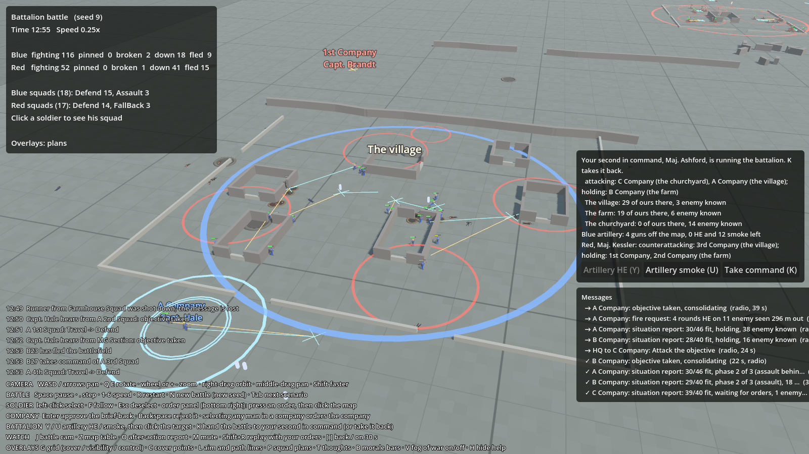
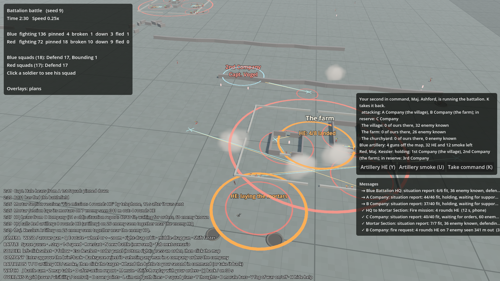

# The battalion battle: battalion commanders, artillery, and overrunning the HQ

## What it is
Milestone 7, part 2. The first battle at battalion scale: three companies a side on a valley a kilometre long, fought
over named places (a village, a farm, a churchyard), and won by **overrunning the enemy's battalion HQ**.

- **Battalion commanders.** Each side has one. Red's (Maj. Kessler) is run by the computer. Blue's (Maj. Ashford) is
  your second in command: he does nothing unless you hand the battle over to him (**K**), and gives it back when you
  press K again. He orders companies, never squads, and the company commanders plan their own attacks as before.
- **Key points.** Named places on the map that the battalion commanders fight over, drawn as a ring with a name.
- **HQs with their own men.** A battalion HQ now has a few staff (clerks, signallers, runners) who defend it.
- **Artillery.** Guns off the map that battalion HQ calls on by radio: slower to arrive than the mortars, but a
  bigger burst. You call it yourself (**Y** for HE, **U** for smoke, then click), and the battalion commanders use it.
- **Who wins.** In a battle with `"victory": "Hq"`, the first side to overrun the other's HQ wins at once. If the
  fighting dies down, or time runs out, with both HQs standing, the defender has held on and wins.

*Thirteen minutes in (seed 9, fog off): A Company has taken the village and Maj. Kessler has sent his reserve to
take it back. The battalion panel on the right shows what both battalion commanders are doing.*

*Earlier in the same battle: Blue's guns on the farm after B Company called it a death trap (4 of 8 shells down),
and Blue's mortars laying on Red infantry they've seen.*

Code:
- `sim/GroundWar.Sim/AI/BattalionCommander.cs`: how a battalion commander thinks.
- `sim/GroundWar.Sim/Units/Battalion.cs`: what he knows (key points, his companies' tasks and news).
- `sim/GroundWar.Sim/Combat/Battle.Battalion.cs`: setting up battalions and key points, company reports reaching
  battalion, handing over, HQs being overrun, the result.
- `sim/GroundWar.Sim/Combat/Battle.Support.cs`: the artillery (search for "artillery").
- `data/scenarios/battalion.json` and its map `data/maps/valley.json` (made by `tools/make_valley_map.py`).
- `game/KeyPointView.cs` draws the key points, `game/CommsView.cs` the HQs (knocked flat when overrun),
  `game/Hud.cs` the battalion panel (search for "battalion").

## Why
The design's player is a battalion commander: he gives orders to companies and watches what his commanders make of
them. That needs an enemy who fights back as a battalion (holding ground, counterattacking, using his reserve), and
a way to win that isn't just "take this farm". The design says a battle is won by destroying the enemy HQ, which
also makes where you put your own HQ matter.

Your second in command is there so you can watch a whole battle fought by both AIs, which is the spectacle the
game is built on, and so the headless runner can fight battalion battles for balance testing.

## How a battalion commander thinks
Every 20 s (`battalion.thinkInterval`) he looks at what he knows. He only knows what has reached his HQ: the
companies' reports (strength, "objective taken", "attack failed", "this is a death trap") and the enemy sightings in
them. A company that has been cut to pieces still looks fresh to him until its next report says otherwise. His own
men's positions he always knows (own troops are never hidden in this game).

**At the start** each company standing on a key point holds it; the companies the scenario names as his reserve
stay back. A defender sends each holding company a "hold" order, so its commander makes a defence plan.

**Who holds what.** A key point is his while one of his companies holds it and still has 30% of its men
(`battalion.spentStrength`). It is the enemy's if enemy are known within 40 m of it (`battalion.keyPointRange`) and
none of his companies hold it. Otherwise it stays as he last believed. When one of his falls, he says so.

**An attacker** (posture `Attack`):
- takes the key points one at a time, **nearest his own HQ first**, then goes for the enemy HQ;
- runs two attacks at once (one if he is a cautious man, aggression below 3), each with a different company;
- picks the fittest company that's free (not attacking, not holding a key point the enemy is near), nearest the
  target. It must have 55% of its men (`battalion.freshStrength`);
- keeps his **reserve** back until an attack on a place has failed, or nobody else is fit to attack;
- calls the artillery on the target as the attack starts, if the enemy are known to be there;
- when a company reports the place **taken**, it holds there, and the next place is attacked;
- when an attack **fails** (the company reports it, or 15 minutes pass, `battalion.attackTimeLimit`), the company
  holds where it is and he waits 3 minutes (`battalion.retryDelay`) before trying that place again;
- when a company **refuses** ("a death trap"), he calls the artillery on the place at once. After 2 minutes
  (`battalion.refusalWait`), if the company hasn't changed its mind, a man of aggression 3 or more **insists** (sends the
  same order again, which the company commander obeys); a more careful man calls the attack off;
- once every key point is his, he sends up to three companies at the enemy HQ.

**A defender** (posture `Defend`):
- holds his key points;
- if enemy come within 350 m of his HQ (`battalion.hqThreatRange`), he brings his reserve back to guard it. A
  careful man (caution 4+) does this at the first sighting; others when three or more are seen;
- when a key point falls, he **counterattacks** it with his reserve, if the enemy known there aren't too many:
  no more than 70% of the reserve's strength, more for a bold man, less for a careful one. A very bold man
  (aggression 4+) will also counterattack with a company that is holding somewhere quiet;
- calls the artillery on the place before the counterattack goes in.

**Both** call the artillery on enemy they know are bunched together: five or more within 40 m of each other
(`battalion.artilleryMinTargets`), seen in the last 90 s, no closer than 110 m to his own men
(`battalion.artilleryDangerClose`), and no more often than every 2 minutes (`battalion.artilleryCooldown`).

Everything he decides goes in the log, in his name ("Maj. Kessler: The village has fallen. Orders 3rd Company to
counterattack the village (6 enemy known there)."). With fog of war on you see only your own side's.

## HQs and how one is overrun
A battalion HQ in a scenario can have `"staff"`: its own men, who hold at the HQ like a squad. An HQ is **overrun**
when enemy men are within 30 m of it (`battalion.hqCaptureRadius`) and none of its own are, for 15 s
(`battalion.hqCaptureTime`). Only in a scenario with `"victory": "Hq"`; in the older scenarios the HQ is just a place.

## Artillery
Each side can have a battery off the map (`"artillery"` in the scenario: guns, HE and smoke rounds). Only battalion
HQ calls it: you (Y / U, then click the target) or a battalion commander. The call goes by radio (25 s,
`support.artilleryCallDelay`), the guns are laid (20 s), and each gun fires a round every 8 s; each shell is in
the air 25 s. So the first shells land a little over a minute after the call. The first salvo falls 55 m either
way of the target; once someone on your side can see the target, later ones close in to 28 m. A shell (`shell_105` in
`weapons.json`) bursts with a 14 m blast and frightens men 45 m away, against 9 m and 30 m for a mortar bomb.
The guns are out of reach, so they only stop when the rounds run out. The HQ must have a radio and still be standing.

## Playing it
Tab to **Battalion battle**. You are Blue's battalion commander, with A and B Companies forward, C Company in reserve,
an MG section that battalion attaches to A Company at the start, a mortar section and four guns. Give your companies
orders as before (select any of their men), or press **K** and watch Maj. Ashford fight it. The battalion panel
(right side) shows who is running your battalion and what he is doing, each key point with how many of your men are
on it and how many enemy are known there, and your artillery. With fog off (V) it also shows what the enemy
battalion commander is doing.

## Tuning
`data/rules.json` → `battalion` (the commander and the HQ) and `support` (`artillery…`). `data/weapons.json` →
`shell_105`. The scenario sets each commander's personality (`battalions` → `traits`), posture and reserve.

## Tests
`BattalionTests.cs`: the player's battalion waits for him until he hands it over; an attacker sends two companies at
the two nearest key points and keeps his reserve; a defender holds his key points; when a key point falls, the reserve
counterattacks it; artillery takes time to arrive and lands around the target; enemy at an undefended HQ overrun it
and win the battle; an HQ still defended is not overrun; older scenarios aren't won that way.

## Results
Runner, 100 battles (seeds 1 to 100), both battalions run by the computer: **Blue 51, Red 49, no draws**. Battles
last 47 minutes on average. Blue wins by overrunning Red's HQ; Red wins when Blue's attack runs out of companies fit
to attack, or time runs out.

Getting there: the first version (Red with three squads in each company and three guns) lost 10 of 12. Red then got
a fourth squad in the village and farm companies, then a fourth in the reserve and a fourth gun. Blue's companies
nearly always say the first attack is a death trap; Maj. Ashford calls the artillery and, two minutes later,
insists. Red's reserve counterattacks a fallen village or farm in most battles. The full runner table is in
[Testing and tuning](../tools/testing.md).

## Not done yet
- **Reinforcements** (companies arriving during the battle) are left for later: the game draws a fixed set of
  soldiers, so they need a way to bring men on during the battle.
- The battalion commander doesn't move his HQ, use his mortars himself, or attach the MG section (the scenario does).
- He doesn't plan a whole battle (a main effort, a feint, timings); he takes one place at a time.
- Your battalion panel counts your men on each key point; it doesn't yet let you order companies from it.
