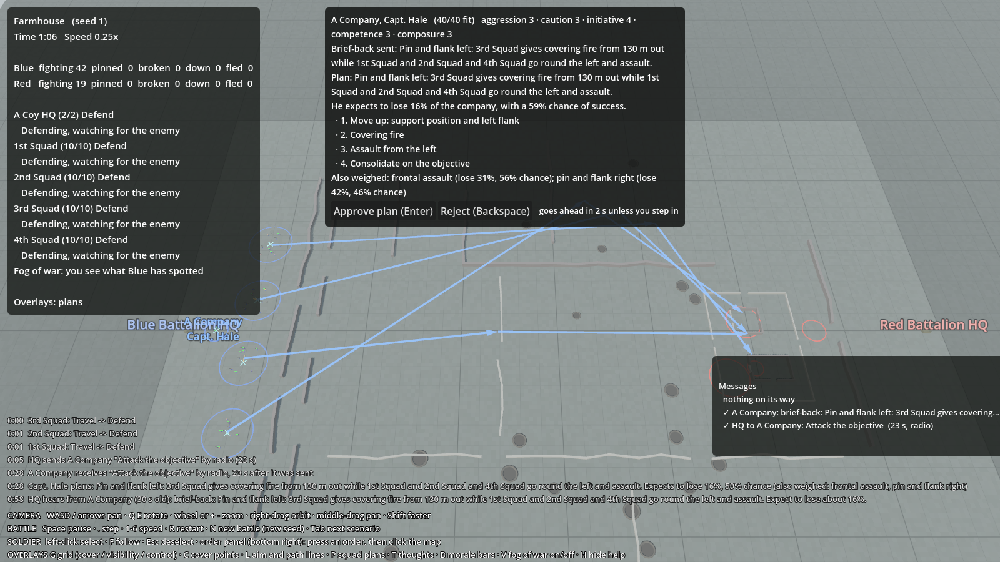

# Company commander

## What it is
Milestone 5. A **company** is a commander with a personality, his HQ (him and a radio operator) and his squads.
You, at battalion HQ, give the company one order ("attack the farmhouse"). The commander turns it into a plan,
**briefs it back** to you, then runs it phase by phase by giving his squads their own orders. He changes the plan
when it goes wrong, and if every way of doing it looks like a death trap he **refuses** and tells you why.

Code: `sim/GroundWar.Sim/AI/CompanyCommander.cs` (the thinking), `sim/GroundWar.Sim/Units/Company.cs` (company,
plan, phase and report types), `sim/GroundWar.Sim/Combat/Battle.Companies.cs` (setting up, messages, brief-back).
Drawing: `game/CompanyView.cs` (plan arrows, HQ flags); the company panel is in `game/Hud.cs`.

## Why
The core of the design is that you never control soldiers directly. You command commanders, and they turn orders
into plans and act on them. This is the layer that makes that true: the player says *what*, the commander decides
*how*, and you can watch him reason about it.



## Setting up a company (scenario file)
```json
"companies": [
  { "name": "A Company", "commander": "Capt. Hale", "hq": "A Coy HQ",
    "squads": ["1st Squad", "2nd Squad", "3rd Squad", "4th Squad"],
    "traits": { "aggression": 3, "caution": 3, "initiative": 4, "competence": 3, "composure": 3 } }
]
```
`hq` and `squads` name groups in the side's `groups` list. The HQ group should have `"radio": true` so battalion
can reach it by radio. Scheduled orders can name a company (`"group": "A Company"`).

## Personality (traits, 1 to 5, default 3)

| Trait | What it changes |
|---|---|
| **Aggression** | Values chance of success and speed more; accepts more risk before calling a plan a death trap |
| **Caution** | Fears losses more; assumes more enemy on an objective he knows nothing about; accepts less risk |
| **Initiative** | 3 or more: switches covering fire onto machine guns that pin his men, and makes a new plan himself when one fails. 2 or less: sticks to the plan, and when it fails he stops and asks for orders |
| **Competence** | How often he takes stock (every 15 − 2 × competence seconds, at least 5) and how far off his estimates are (± 8% per point below 5) |
| **Composure** | Accepts a little more risk; with composure 2 or less he pulls his men back on his own when an attack fails badly |

## How he makes a plan
When an order arrives he builds every plan that fits it:

| Order | Plans he weighs up |
|---|---|
| Attack | **Frontal assault** (all squads form up on a start line 170 m out and go in together); **Pin and flank left**; **Pin and flank right** |
| Advance | All squads abreast to the objective, then hold it |
| Hold | Squads in a line 40 m apart across the objective, facing the enemy |
| Suppress | Whole company gives covering fire from the support position |
| Halt, Fall back | Passed straight to every squad, no plan |

**Pin and flank:** the squad with the most machine guns moves to a support position about 130 m short of the
objective (the spot with the best cover and a clear view of it). The other squads move to an assembly area 70 m to
the side and 40 m short. Then the phases: **move up**, **covering fire** (20 s at least, once the support squad is
firing), **assault from the flank**, **consolidate** on the objective.

### Judging a plan
He estimates three things for each plan:
- **Expected loss**: for every leg of every squad's route (path-found around walls), every 15 m he works out how much
  enemy fire could reach that spot: each enemy he knows of that has a line of sight, weaker with range (nothing past
  450 m), less where there is cover to use. A machine gun counts as 3 rifles. Seconds spent there × that fire =
  exposure. Squads assaulting under covering fire count half or less; a support squad firing from cover counts a third.
  Loss = 1 − e^(−0.00045 × exposure) per squad (`company.exposureLethality`).
- **Chance of success**: the men left to assault against the enemy's fire, better from a flank.
- **Speed**: how long the phases will take.

If he knows nothing about the objective, he **assumes** an enemy there worth 6 + 2 × caution rifles, who can see from
anywhere on the objective's edge. When he knows a little, he still assumes half of what's missing.

The score: success × (1 + 0.15 × (aggression − 3)) − loss × (1.5 + 0.3 × (caution − 3)) + speed × (0.3 + 0.1 ×
(aggression − 3)). Best score wins. The plans he turned down are listed in the brief-back with their estimates.

### Death traps and refusing
A plan is a death trap if expected loss is above **35% + 7% × (aggression − 3) − 5% × (caution − 3) + 3% × (composure −
3)**, or its chance of success is under 30%. If even the best plan is a death trap he **refuses**: he holds where he
is and radios battalion, for example *"cannot carry out 'Attack the objective': expect to lose about 61% of the company
to 3 machine guns, with a 18% chance of taking it. Request support. Send the order again if it must be done."*
**If you send the same order again** (same kind, objective within 25 m) he says "Understood" and does it whatever he
thinks.

## The brief-back
Your commanders send their plan to battalion HQ before they act (by radio, so it takes about 30 s). When it arrives,
the company panel (top middle) shows the plan, its phases, what he expects to lose and the plans he turned down, with
**Approve** (Enter) and **Reject** (Backspace) buttons and a countdown. **If you do nothing for 10 s it goes ahead**
(`comms.briefBackWait`). Your answer takes 5 s to reach him, as he is waiting on the radio for it
(`comms.briefBackReplyDelay`); without a radio it goes by runner. Reject and he stands down to wait for a new order.
If no answer reaches him in 150 s (a runner shot) he goes ahead.

The enemy's commanders don't brief back to anyone: they start at once.

## Running the plan
Each phase, he sends every squad its order (see below for how). Moving to a start line, assembly area or support
position is a **waypoint** order: getting there isn't "taking" anything. He moves on when:

| Phase | Done when |
|---|---|
| Move up | Every squad has its order and has got there. After its time limit (5–6 min), if at least half are there he goes on anyway |
| Covering fire | 20 s have passed and the support squad is firing |
| Assault | A squad reports the objective taken (then everyone consolidates). If every assaulting squad reports failure or breaks, the assault has failed |
| Consolidate / Hold | Straight away: he reports "objective taken" to battalion |

**Changing his mind.** He thinks again when: he has lost 35% of the men he had when he made the plan; a machine gun
he didn't plan for turns up before the assault; a phase runs past its time limit; or the assault fails. If the plan
he's running is still the best, he carries on with it. Otherwise he makes a new one and goes straight into it (telling
battalion, no brief-back). After two new plans for one order, or if his initiative is low, he halts and asks for
orders. If the new best plan is a death trap he refuses mid-attack: halts, or with poor composure pulls back.

**Shifting fire.** In the covering fire and assault phases, if a squad reports being pinned and he knows of a machine
gun within 150 m of it, he orders the support squad to switch its fire onto that gun (once per gun). If battalion
has mortars, he also asks for fire on the gun (from moving up onwards): smoke if he's careful, HE if not.

**Mortar fire (milestone 7).** With mortars in the battalion he books on-call fire when the plan starts and calls it as the assault goes in, asks for it when a
squad is pinned, asks for it when he refuses an attack (and thinks again once it has landed), and fires on attackers
he sees coming while holding. All of this is in [Battalion support](support-fire.md).

**His HQ** stays about 60 m behind the middle of his squads, at whichever of a few spots there is least in view of
the enemy he knows about. If his HQ group is wiped out or breaks, he is **down**: the squads carry on with their last
orders and report straight to battalion again.

## Messages inside the company
Squads in a company report to their **company commander**, not battalion. He gives his orders and hears their
reports by:

| Method | When | Time |
|---|---|---|
| **Voice** | The squad's sergeant is within 60 m of him (`comms.voiceRange`) | 3 s |
| **Company radio** | Both have a set | 10 s ± 4 (plain speech on a short-range net) |
| **Runner** | Otherwise | Distance ÷ 3 m/s, and can be shot like any runner |

He passes on what matters to battalion: a situation report every 60 s (strength, phase, enemy known, with his picture
of the enemy attached), plus the brief-back, refusals, changes of plan and "objective taken". So the player's picture
of the enemy now comes through two layers of reports. The messages panel shows battalion's own traffic only.

## What the player sees
- **Company panel** (top middle): the commander, his traits, what he's doing, the plan with its phases (✓ done, ▶ now),
  his estimates, the plans he turned down, and the Approve / Reject buttons when a brief-back is waiting. It shows the
  company waiting for an answer first, otherwise the selected man's company, otherwise your only company.
- **Plan arrows** on the ground in the company's colour while the plan is briefed back or running: the phase he's on is
  bright, phases done are faint.
- **A flag** over each company HQ with the company and commander's names.
- **Order panel**: selecting any man in a company orders the **company** (through its commander), not his squad.

## Tuning
`data/rules.json` → `company` (death trap level, assumed enemy, lethality of exposure, distances, covering fire time,
how far back the HQ stays, when he re-plans) and `comms` (voice range and delay, company radio, sitrep interval,
brief-back wait and reply delay).

## Tests
`CompanyTests.cs`: he briefs back and nobody moves until HQ answers, then squads get their orders; at the farmhouse he
chooses to pin and flank by the covered left, cheaper than going straight in, with the two-gun squad in support;
rejecting stands the company down; approving starts it at once; a cautious man refuses a death trap and obeys when HQ
insists; bold men accept more risk; squads report to him and he reports to battalion; voice when close, runner when
far; the farmhouse battle is repeatable.

## Results
"Farmhouse" (40 men in 4 squads attack 19 in a walled farm and barn): in the first 40 battles Blue won 23, Red 16, one
draw. Captain Hale always chose to pin and flank by the covered left at first, and re-planned after heavy losses in
about half the battles. See the runner table in [Testing and tuning](../tools/testing.md) for the 200-battle figures.

## Tanks in the plan (milestone 8)
When battalion attaches a tank platoon to the company, he gives it a part in every plan he weighs: covering fire with
the support squad and then the assault (pin and flank), leading the assault (frontal), behind the line (defend), and
so on, and counts it in the odds. Tanks that arrive after he has planned are fitted into the plan he is running; if he
had refused the attack, he thinks again. See [Tanks](tanks.md#tanks-in-the-company-plan-companycommanderaddtanks).

## Not done yet
- When the commander is down, nobody takes over the company (the senior sergeant should).
- Mortars and MG sections arrived in milestone 7 part 1 ([Battalion support](support-fire.md)); artillery comes with the battalion battle.
- The enemy company only defends where it is put (no counter-attacks) until the enemy battalion AI (milestone 7).
