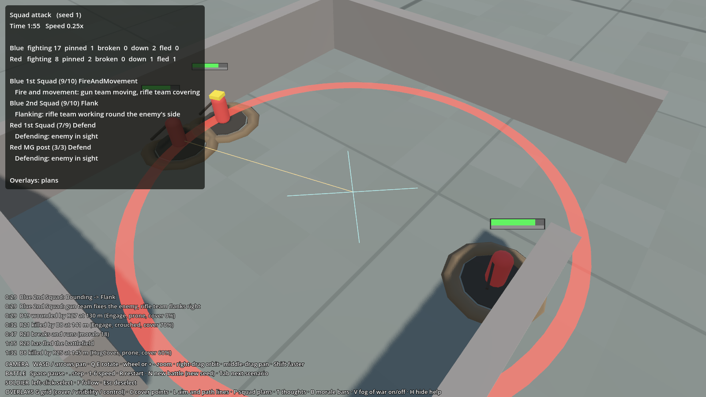

# Map and cover

## What it is
The ground the battle is fought on: walls, craters, the cover spots soldiers use, how much a spot protects a
man from a given direction, foxholes dug during the battle, the battlefield grid, and path finding.

Hills, woods, hedgerows and crops have their own page: [The ground](terrain.md).

## Map files
`data/maps/*.json`. Positions are in metres; x runs east, y runs south (in Godot, sim y becomes the z axis).

- **Walls**: a line from `a` to `b` with a `thickness`. `high: false` is a low wall you can fire over
  (1 m tall). `high: true` is a ruin wall (2.6 m) that blocks sight and bullets completely.
- **Craters**: a `center` and `radius`. They give all-round cover and slow movement.

Maps in the game: `test_range` (the original test field), `meeting_field` and `meeting_field_b` to `_f`
(built so they look the same from both ends, for fair tests), `town` (dense streets, made by `tools/make_town_map.py`),
and `stress_field` (big, for 1,000 a side).

## Cover points
**Why:** soldiers need a list of "good places to be", not to work out geometry every time they think.

**How:** when the map loads (`BattleMap.GenerateCover`), cover points are placed every 2 m along both faces of every
wall, and around every crater. Each has:
- a **kind**: low wall, high wall, crater or foxhole;
- a **facing**: which way it protects (towards the wall). Craters and foxholes protect all round;
- a **strength**: how much it protects;
- **can fire**: false for the middle of a high wall (safe, but you can't see out). The ends of a high wall are
  "corners" you can lean out of and shoot from;
- **claimed by**: one man per spot, so a squad spreads out along a wall instead of piling up.

Press **C** in the game to see them: green low wall, yellow crater, cyan corner of a ruin, blue hiding spot,
brown foxhole, orange claimed.

## How much cover protects
`BattleMap.ProtectionAt(position, from)` answers "how protected is a man here from fire coming from there?",
from 0 (open) to 1 (completely hidden):

| Situation | Protection | Tuning (`rules.json` → `combat`) |
|---|---|---|
| A high wall is between them | 1.0 (can't be seen or hit) | |
| Behind a low wall within 1.8 m, and the line of fire crosses it | 0.7 | `lowWallProtection`, `coverCheckDistance` |
| Inside a crater, shooter outside it | 0.6 | `craterProtection` |
| Inside a foxhole, shooter outside it | 0.75 | `foxholeProtection` |

Protection cuts the chance to be hit and part of the fear from near misses (see
[Spotting and shooting](spotting-and-shooting.md)). A wall only protects if the shot actually crosses it, so a man
behind a wall can still be shot from the side: that's why flanking works.

## Foxholes (digging in)
**What:** soldiers of a squad told to **Hold** dig foxholes on their own when nothing is happening. This is the
"dig in on their own when told to hold" item from milestone 3 of the Build Plan.

**How:** in [Soldier AI](soldier-ai.md), "dig" is an option a man considers when all of these are true:
- his squad's order is Hold, and he is in his place;
- he has nothing to shoot at, nowhere better to go, and isn't pinned or broken;
- nobody has shot at him for 10 seconds (`ai.digQuietTime`).

While digging he crouches and his thought reads "Digging a foxhole (40%)". After 90 seconds of digging
(`ai.digTime`) a foxhole appears where he stands (`BattleMap.AddFoxhole`) and he is in it. If he's interrupted,
he keeps his progress as long as he comes back to the same spot. Attackers never dig.

**Why it matters:** a foxhole protects from every direction, better than a crater, so a defence that has had
time to dig in is much harder to crack. Adding it lowered Blue's win rate in "Squad attack" from about 88% to
about 63% and in "Town attack" from about 25% to about 13%.

**Drawing:** `game/MapView.cs` redraws foxholes (a dark hole with a ring of dug earth) whenever a new one appears.

## The battlefield grid
`Map/BattleGrid.cs`. The map is cut into 5 m squares, each scored for:
- **cover**: the best cover point in the square;
- **visibility**: how open the view is (16 sight lines, 150 m long, how many are not blocked);
- **height**: the ground height in metres (see [The ground](terrain.md));
- **control**: which side holds the square, from nearby fighting men; refreshed once a second.

Every AI layer can read it. Press **G** to cycle the overlay: cover → visibility → control → off.

## Path finding
`Map/NavGrid.cs`. A 1 m grid of walkable squares (walls block, with a small clearance) and A* path finding.
Craters are walkable but slow a man down (`soldier.craterSpeedFactor`).

## Tests
`sim/GroundWar.Sim.Tests/MapTests.cs` (cover points on both sides of walls, protection, sight lines),
`FairnessTests.cs` (the meeting maps are the same from both ends), `SquadTests.cs → DiggingTests`
(defenders dig, attackers don't, a foxhole protects from every side).
