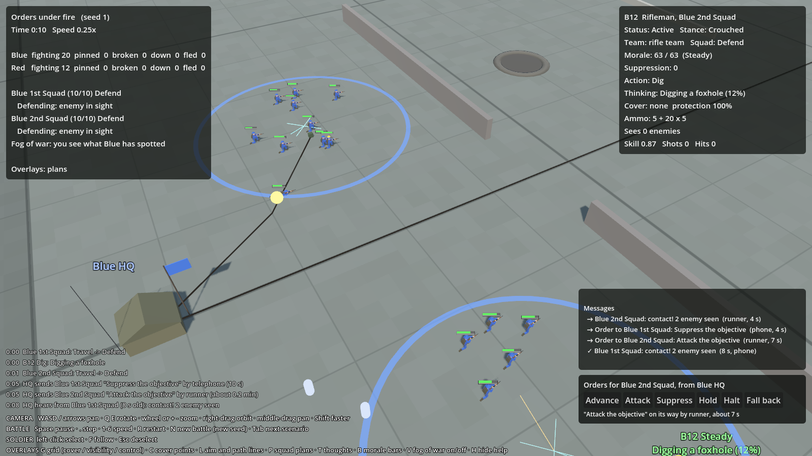

# Messages and delay

## What it is
Milestone 4. Orders go from a side's **HQ** to its squads, and reports come back, by **field telephone**, **radio**,
**runner** or **flare**. Every one of them takes time, runners can be shot, and phone lines can be cut by shellfire.
What HQ (and so the player) knows about the enemy is only what reports have brought in.
Code: `sim/GroundWar.Sim/Comms/Messages.cs` (types) and `sim/GroundWar.Sim/Combat/Battle.Comms.cs` (logic);
drawing in `game/CommsView.cs`; the order and message panels in `game/Hud.cs`.

## Why
Order delay is a core rule of the design: *every* order, even halt and fall back, arrives late, and planning around
that is part of the skill. Late, patchy reports are also where believable mistakes come from.

**Design rule (Jimmy, 1 Nov):** your own troops are always shown live. Only the enemy is hidden, and only orders are
delayed: your view of your own men is not.

## The pieces
- **HQ**: set per side in the scenario (`"hq": { "name", "position", "radio" }`). A scenario side without an HQ
  works the old way: orders are instant and the player sees every sighting at once.
- **Telephone lines**: `"phoneLines": [ { "points": [[x,y], ...] } ]` per side. Each runs from HQ along the points; the last
  point is the phone. A squad can use it if its sergeant is within 25 m of that end (`comms.phoneReach`).
- **Squad radios**: `"radio": true` on a group. Rare for WW2 squads; company HQs will have them from milestone 5.

## How a message travels
HQ picks the fastest way that works right now (`Battle.BestMethod`):

| Method | When it can be used | Time | What can go wrong |
|---|---|---|---|
| **Flare** | Only for Halt and Fall back, and only if the squad's sergeant can see HQ within 1.5 km | 6 s | |
| **Telephone** | A working line ends near the squad's sergeant | 12 s ± 5 | A shell bursting within 3 m of the cable cuts it. If the line is cut before the message is through, it's resent another way |
| **Radio** | HQ and the squad both have a set | 30 s ± 10 (coding, sending, decoding) | 15% of the time it has to be sent again: double the time |
| **Runner** | Always | Distance ÷ 3 m/s; he chases the squad if it moves | Enemies who can see him may shoot him. The message is lost. If he carried an order, HQ sends it again a minute later |

A runner's danger: once a second, each enemy within 250 m who can see him and isn't pinned adds 0.4% (less further
away), capped at 15% a second.

## Orders
`Battle.SendOrder(group, order)`. On arrival (`Battle.ApplyOrder`) the squad leader takes it on at once:

| Order | Effect |
|---|---|
| Advance | Move to the objective, fight on the way, hold it |
| Attack | Take the objective from the enemy |
| Suppress | Fire on the objective from where the squad is (or a given support position) |
| Hold | Defend the given place |
| Halt | Stop and hold where the squad is now |
| Fall back | Pull back about 80 m and hold there |

Scenarios can schedule orders (`"orders": [ { "time", "group", "order", "objective", ... } ]`). They're sent from HQ at
that time and travel like any other: this is how the enemy follows a plan until the enemy commander arrives (milestone 7).

## Reports
Each squad sergeant reports to HQ (`Battle.WriteReports`), by the same routes:
- **Contact**: the first time the squad sees the enemy.
- **Situation report** every 30 s while in contact (`comms.sitrepInterval`): strength, how many enemy known, what it's doing.
- **Heavy casualties** at each quarter of the squad lost, **pinned down**, **broken**, **objective taken**, **attack failed**.

Contact, situation and some other reports carry the squad's sightings *as they were when written*. When the report
arrives, HQ adds them to its picture of the enemy (`Headquarters.Knowledge`), keeping each sighting's original time.
HQ forgets a sighting 2 minutes after it was made (`comms.hqContactMemory`).

## What the player sees
- **The enemy**: only as HQ knows it (`comms.playerSeesReportsOnly`, on by default). Set it to `false` in `data/rules.json`
  to see every sighting the moment any of your men makes it.
- **HQ**: a command tent with a flag in the side's colour and a radio mast.
- **Telephone cables**: dark lines on the ground with a field telephone box at the end; red where cut.
- **Messages moving**: a runner is a small light figure running across the map; a phone call is a yellow pulse running
  along the cable; radio traffic is rings spreading from the sender; a flare is a red light rising over HQ.
- **Messages panel** (bottom right): messages on their way with time left, and the last few delivered (✓) or lost (✗).
- **Order panel** (bottom right, when one of your soldiers is selected): Advance, Attack, Suppress, Hold need a place:
  press the button, then click the map. Halt and Fall back go at once. Below the buttons: where your last order to that
  squad is and how long it has left. Esc cancels a half-given order.
- The **log** shows each order sent, received (and how long it took), each report HQ hears, lost runners and cut lines.

## Tuning
`data/rules.json` → `comms`: every delay, range and chance above.

## Tests
`CommsTests.cs`: a phone order arrives after the delay and not before; a squad with no phone gets a runner who moves
across the map; a cut line means a runner; halt goes by flare when the squad can see HQ; without an HQ orders are
instant; the player only sees the enemy when a report reaches HQ.

## Results
"Orders under fire" (the squad attack with real orders and reports, 200 battles): Blue 117, Red 83 (the same attack with
instant orders: Blue 127). Delays cost the attacker a little.
