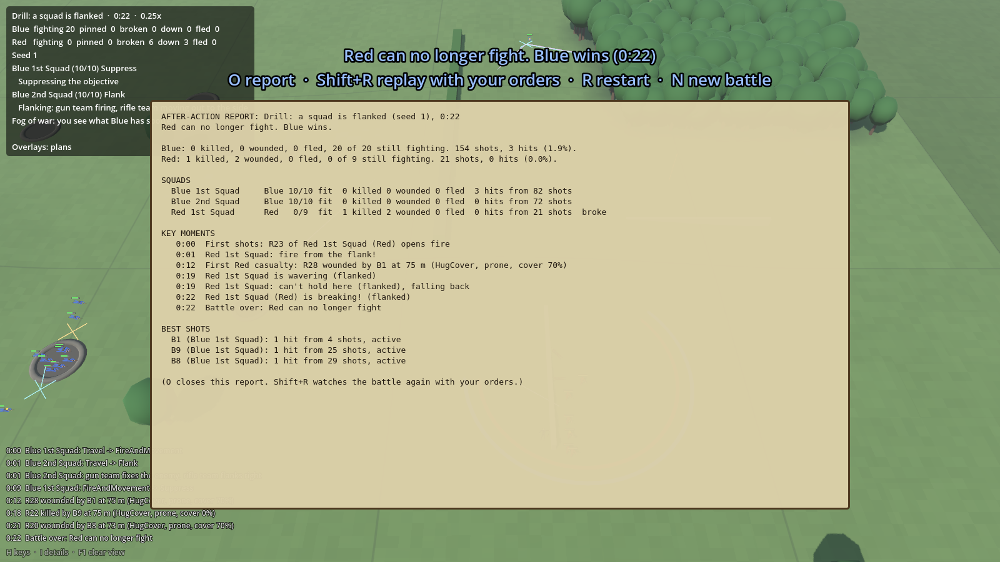

# Morale and suppression

## What it is
Two numbers on every soldier that decide how willing he is to fight. Code: `sim/GroundWar.Sim/Combat/Battle.Morale.cs`,
plus the morale hits in `Battle.Combat.cs`. Tuning: `data/rules.json` → `morale`.

- **Suppression** (0–100) is short-term fear: bullets passing close right now. It rises fast and fades fast.
- **Morale** (starts 60–85, sergeants +10) is longer-term nerve. It drops with bad events and recovers slowly.

## Why
The game's battles should be won by breaking the enemy's will, the way real small-unit fights mostly were, not by
killing every man. Suppression is what makes fire and movement work: one team's fire keeps the enemy's heads down
while the other moves.

## States
| State | When | Effect |
|---|---|---|
| Steady | Normal | Fights normally |
| Shaken | Morale < 50 or suppression ≥ 35 | Shoots worse |
| Pinned | Morale < 32 or suppression ≥ 55 | Won't advance; stays put or crawls |
| Broken | Morale < 18 | Runs for the rear and ignores orders; leaves the map if he gets there ("fled") |

Above 80 suppression a man can't fire at all and just hugs the ground.

## What changes them
**Suppression** comes from near misses (see [Spotting and shooting](spotting-and-shooting.md)). After 2 s with no
new near misses it fades by 8 a second.

**Morale goes down:**
| Event | Amount |
|---|---|
| Each point of suppression | −0.05 |
| A friend within 25 m killed / wounded | −12 / −7 (less if further away) |
| His sergeant hit | −15 to the whole squad (once per 30 s) |
| Half his squad's men have broken | The whole squad breaks (see squad cohesion below). For an HQ or a tank crew, which have no squad nerve: −12 to the rest, once |
| Alone (no friend within 15 m) | −0.3 a second |
| Out of ammunition | −0.5 a second |

**Morale goes up** (only while suppression is under 10):
| Situation | Per second |
|---|---|
| Always | +0.4 |
| In good cover | +0.3 |
| His sergeant within 25 m | +0.3 |
| Seeing an enemy go down | +3 (once) |

It never goes above where he started.

**Rallying:** a broken man rallies once his morale is back above 40 and no known enemy is within 80 m. If his
whole squad has broken he rallies with the squad instead (below).

**Where a broken man runs to.** Not straight off the map any more. He runs for his squad's **rally point**: a spot
about 110 m to the rear, out of the enemy's sight if the ground offers one. There he lies flat and gets his nerve
back. If the squad has its back to the edge of the field, or the enemy turns up at the rally point, there is nowhere
to stop and he runs off the field ("fled") as before.

## Squad cohesion: the squad's nerve as a unit
Step 3 of the core AI rework (November 2026). Code: `sim/GroundWar.Sim/Combat/Battle.Cohesion.cs`, the squad
leader's side of it in `AI/SquadBrain.cs` (`GiveUp`, `GoToGround`, `Defend`). Tuning: `data/rules.json` → `cohesion`.

### What it is
Every squad has one more number, **cohesion** (0 to 100, starts at 100): how well the squad is holding together.
Each man still has his own morale, but it is cohesion that makes a squad stop, pull back or run **together**.

| Squad nerve | Cohesion | What the squad does |
|---|---|---|
| **Steady** | 60 and up | Follows its orders |
| **Shaken** | under 60 | On the attack: goes to ground where it is and shoots back, until it steadies. It won't start an assault. An assault already within 35 m of the enemy carries on |
| **Wavering** | under 40 | On the attack: "the men have had enough". It gives up, pulls back about 60 m (out of sight if it can) and holds there; the attack counts as failed. Defending: if the enemy is within 80 m, on its flank or behind it, it falls back about 80 m to the next position |
| **Broken** | under 20 | The whole squad runs for its rally point |

A state only lifts once cohesion is 8 points back above its line, so squads don't flicker between two states.

### Why
The core AI review found that fights ended by killing, not by breaking: the beaten side had 53 to 81% of its men
hit, squads fought on until half were down, and nobody ever came back. The old rule was "a squad quits when under
40% of its men can fight", which is a count of bodies, not of nerve. Real squads stop long before that, and for
reasons that have little to do with the count: being surprised, being shot at from the side, losing the
sergeant, seeing the squad next door run.

Each man's morale stays because it is what makes one man freeze while his mate keeps shooting. Cohesion sits on
top because men decide to go together.

### What moves it
**Down:**
| Event | Amount |
|---|---|
| A man hit | −14 in a squad of ten (`casualtyShock`). A smaller squad feels each loss more: −35 in a team of four |
| The sergeant hit | −12 more (`leaderLost`) |
| Fired on by an enemy the squad knew nothing about | −8 (`surpriseShock`); **−16 inside 80 m (an ambush)** |
| Fire from the flank (see below) | −14 at once (`flankedShock`), then −1.2 a second while it lasts. Each man also loses 6 of his own morale |
| Enemy known behind the squad, within 150 m, on its way out | −1 a second (`cutOffDrainPerSecond`) |
| Men pinned, while under fire | −0.4 a second if all of them are, in proportion with fewer |
| A squad of the same side breaks within 120 m | −8 (`neighbourBroke`): panic spreads |

**Up:** only once nobody has shot at the squad for 8 s (`quietTime`): +0.5 a second, +0.3 more with a sergeant alive.

**The ceiling.** Cohesion can never rise above 100 minus 1.9 for every 1% of the squad hit
(`ceilingPerLossPercent`). So losses are permanent:

| Squad of ten has lost | Best it can ever be again |
|---|---|
| 1 man | 81: steady |
| 2 men | 62: just steady |
| 3 men | 43: shaken for good. It will hold ground and shoot, but not attack |
| 4 men | 24: wavering for good, and too low to rally if it breaks |
| 5 men | 5: broken |

That table is the heart of it: **a squad is finished as an attacking force at about 30% losses and finished
altogether at 40 to 50%.**

### Flanked
A squad's **front** is wherever the enemy first showed himself: the first fire it took, or the first enemy it
saw. (Not the facing in the scenario file, which is only a guess.) Fire coming from more than 70° off that front
(`flankAngle`) is flank fire. The squad is **flanked** when two or more of its men are being shot at from off the
front, or one is while others are still being shot at from the front (a crossfire).

Being flanked costs cohesion at once and keeps costing it. If the fire from the old front then stops for 20 s
(`turnToFaceTime`), the squad has turned to face the new direction: that is now its front, a defending squad's
men pick their cover against it, and the squad is no longer flanked. After 30 s with no fire at all the front is
forgotten and the next enemy to appear sets it afresh.

On top of this, flank fire was already deadlier in the plain mechanics: a wall only protects against fire that
crosses it.

### Breaking and rallying as a squad
When cohesion drops under 20 (or half the squad's men have broken one by one), the squad **breaks**: every man
is broken at once and they run for the rally point together. Squads of the same side nearby take a knock.

A broken squad **rallies** when all of these are true: most of its men have reached the rally point, nobody has
shot at them for 8 s, and cohesion has climbed back above 32 (`rallyAt`). It then holds where it is, wavering,
with every man shaken. It will defend. With the ceiling above, a squad that lost 4 in 10 can never get back to
32, so it stays out of the battle for good, lying up at its rally point.

A squad that gave up an attack on its own account (wavering, not broken) and later gets all the way back to
steady **goes in again** with its old order, unless its commander has sent it a new one in the meantime.

Company commanders leave wavering and broken squads out when they make a new plan.

### Who has it
Squads of men on foot, including MG and mortar sections. Not tanks, tank crews, company HQs or the battalion
HQ's staff: those behave as before.

### What it did to the battles
100 battles of each scenario before and after (12 November 2026), from the [realism report](realism-report.md).
Each cell is before → after. A `*` marks a value outside its target.

| Measure | Target | Farmhouse | Squad attack | Meeting | Drill: MG | Drill: flanked | Drill: ambush |
|---|---|---|---|---|---|---|---|
| Men out of the fight who ran rather than were hit | 30–75% | 19%* → 41% | 18%* → 32% | 34% → 54% | 24%* → 47% | 43% → 66% | 17%* → 47% |
| Beaten side: men hit by the end | 10–40% | 59%* → 40%* | 53%* → 42%* | 62%* → 38% | 72%* → 46%* | 53%* → 29% | 81%* → 46%* |
| Winning side: men hit by the end | 3–25% | 37%* → 22% | 32%* → 24% | 17% → 15% | 10% → 7% | 4% → 3% | 20% → 11% |
| A squad breaks after losing | 15–45% | 47%* → 36% | 51%* → 39% | 61%* → 38% | 60%* → 46%* | 51%* → 29% | 73%* → 46%* |
| Squads shot down to half strength or less | 0–15% | 54%* → 21%* | 58%* → 31%* | 52%* → 6% | 64%* → 59%* | 45%* → 0% | 76%* → 39%* |
| Time under fire spent pinned down | 30–70% | 34% → 39% | 37% → 36% | 31% → 28%* | 45% → 44% | 45% → 35% | 28%* → 31% |
| Moving men bunched up | 0–15% | 30%* → 31%* | 34%* → 37%* | 27%* → 30%* | 19%* → 19%* | 29%* → 31%* | 21%* → 22%* |
| Typical range of rifle and MG fire | 50–300 m | 145 → 175 m | 135 → 135 m | 155 → 165 m | 135 → 145 m | 85 → 95 m | 55 → 65 m |
| Rounds fired per man hit | 150–2,000 | 65* → 91* | 84* → 85* | 116* → 107* | 61* → 76* | 42* → 41* | 22* → 28* |
| Men hit who are killed outright | 20–35% | 45%* → 26% | 44%* → 25% | 45%* → 27% | 45%* → 29% | 43%* → 25% | 44%* → 28% |
| **In range** | | **2 → 6** | **2 → 6** | **4 → 7** | **3 → 5** | **4 → 8** | **2 → 5** |
| Broken men who rally | | 4% → 31% | 0% → 5% | 0% → 33% | 0% → 2% | 0% → 0% | 1% → 9% |
| Length of the fight | | 13.1 → 10.4 min | 10.2 → 8.3 min | 6.7 → 3.4 min | 1.8 → 1.5 min | 0.6 → 0.3 min | 1.5 → 0.9 min |

**Overall: 17 → 37 of 60 in range.**

In plain words:
- **The beaten side now has about 30 to 45% of its men hit, where it was 53 to 81%.** Still a little high in four
  of the six, mostly because shooting is still too deadly (step 4): men are hit while the squad is making up its mind.
- **About half the men who leave a fight now do it by running**, where it was one in five.
- **Squads break at 29 to 46% losses**, where it was 47 to 73%. Squads shot to half strength fell from about half
  of all squads to a fifth in the Farmhouse and to none in the flanked drill.
- **Men rally**: a third of broken men come back in the Farmhouse and the meeting engagement. In the one-squad
  drills hardly any do, because the battle is over the moment the only squad breaks.
- **The winner pays less**: 22% in the Farmhouse, down from 37%, because attacks that are going badly now stop.
- "Men hit who are killed outright" is in range because `soldier.killChanceOnHit` went from 0.45 to 0.28 in this
  step. That is a plain tuning change, not AI.
- **Not moved, as expected:** bunching and rounds per man hit. Those are step 4.

Who wins also changed, because attacks now stall:

| Scenario (100 battles) | Blue / Red / draw before | After |
|---|---|---|
| Farmhouse (company attack) | 80 / 18 / 2 | 55 / 42 / 3 |
| Squad attack | 61 / 39 / 0 | 40 / 59 / 1 |
| Meeting engagement | 43 / 49 / 8 | 52 / 48 / 0 |
| Drill: squad meets a machine gun | 100 / 0 / 0 | 97 / 3 / 0 |
| Drill: a squad is flanked | 100 / 0 / 0 | 100 / 0 / 0 |
| Drill: ambush | 16 / 84 / 0 | 21 / 79 / 0 |

40 battles each of the others: Firefight 9 / 31, Town attack 4 / 36, Tank support 35 / 5, Orders under fire
13 / 27, Farmhouse with support 36 / 4, Tank platoons 31 / 9.

**Known gaps after this step:**
- **The battalion battle now favours the defender heavily.** In 3 test battles the attacking battalion never got
  through and all three ran to the hour (it was 6 / 9 of 15 before). Squads stop attacking at about 30% losses and
  the company and battalion commanders don't yet know how to pass a fresh squad through a spent one or call the
  whole thing off. That is step 5.
- A machine-gun team in a hedge still loses to a squad in the open 97 times in 100. The gun doesn't do enough
  (step 4), and a four-man team is at half strength after two hits whatever its nerve.
- A battle ends the moment every man on one side is broken, so a lone squad that breaks never gets the chance to rally.
- Being flanked is judged from where the fire comes from, not from where the enemy is. A squad isn't worried by
  an enemy working round its side until he starts shooting.

### Tests
`CohesionTests.cs`: a fresh squad is steady; losses shake a squad and cap how far it can recover; a squad that
has lost four in ten cannot rally; a broken squad runs back together and rallies when left alone; a squad with
its back to the edge runs off the field; a wavering attacker gives up and goes in again once steady; fire from
an unseen enemy is a shock, twice as bad up close; a squad hit from the flank notices and usually breaks before
half are down; HQs and tanks have no squad nerve.

## Seeing it in the game
The top-left panel adds the squad's nerve after its tactic when it isn't steady ("· shaken", "· wavering, flanked",
"· BROKEN"). Click a man and his panel shows "Squad nerve: Wavering (38) FLANKED". The log has a line each time a
squad is ambushed, flanked, shaken, wavering, breaking, turning to face, rallying or going in again.

**B** shows a bar above each man: the top is morale (green steady, yellow shaken, orange pinned, red broken), the
bottom fills yellow with suppression. The top-left panel counts fighting, pinned, broken, down and fled for each side.

## Tests
`BattleTests.cs` (suppression fades when the shooting stops; a broken soldier runs for the rear).
