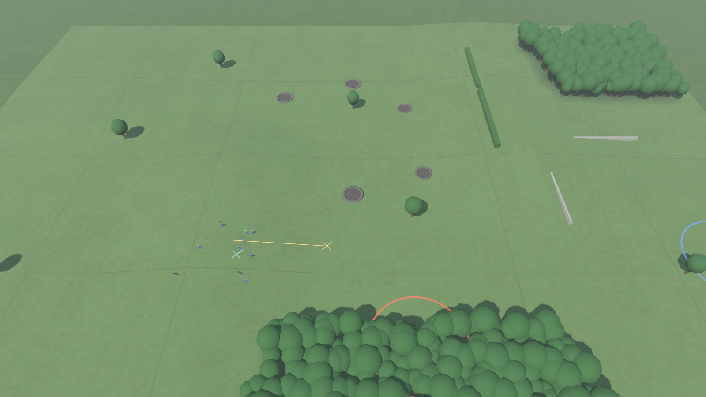

# The realism report and the drills

## What it is
A yardstick. The realism report watches battles and measures **how they are fought**, not who wins: how many men
run rather than die, how badly a side is hurt before it gives up, how long men spend pinned, how bunched up they
move, how many rounds it takes to hit somebody. Each number is compared with a target range for a believable
WW2 infantry fight, and the report prints `ok` or `MISS` beside it.

With it come three **drills**: tiny scenarios (a squad or two a side) that each set up one classic situation, so
one piece of behaviour can be watched and measured on its own.

This is step 2 of the core AI rework (November 2026). Step 1 was [the ground](terrain.md).



## Why
The win/loss tables we had could not see the real problem. A scenario can be "balanced" at 50/50 while every
battle in it is a massacre that no real unit would have fought. The core AI review found exactly that: attacks
carried on far past realistic losses, and fights ended by killing rather than by one side breaking.

The next three steps (morale and cohesion, squad battle drill, company commanders) are all meant to fix *how*
battles are fought. Without numbers, "it feels better" is the only test. With the report, every one of those
pull requests shows the same table before and after, and we can see which measures moved into range and which
did not.

The report **only watches**. It never changes a battle (there is a test for that), and nothing in the game
reads it.

## The measures
The first ten have targets. The rest are for information.

| Measure | What it counts | Target | Why that target |
|---|---|---|---|
| Men out of the fight who ran rather than were hit | Of everyone who is dead, wounded, routed or broken at the end, the share who ran | 30–75% | Real fights were mostly settled by men giving up the ground, not by everyone being shot |
| Beaten side: men hit by the end | Killed and wounded on the side that lost | 10–40% | A beaten platoon or company usually gave up long before half its men were hit |
| Winning side: men hit by the end | Killed and wounded on the side that won | 3–25% | A win that costs a third of the force is a disaster, and a real commander would have called it off |
| A squad breaks after losing | How much of a squad had been hit at the moment it broke (average) | 15–45% | Squads fall apart when a few men go down, not when most have |
| Squads shot down to half strength or less | Of the squads that took part, the share that lost half their men or more | 0–15% | Should be rare: a squad that has lost half its men has normally stopped fighting long before |
| Time under fire spent pinned down | Of all the seconds men spend being shot at, the share spent pinned or broken | 30–70% | Fire mostly pins. It rarely kills. Men under fire who carry on as normal are robots |
| Moving men bunched up | Men on the move with a squad mate within 2 m (checked once a second) | 0–15% | Trained men keep about 5 m apart so one burst doesn't get two of them |
| Typical range of rifle and MG fire | The middle (median) distance from shooter to where the round lands | 50–300 m | The usual span of WW2 infantry firefights |
| Rounds fired per man hit | Rifle and machine-gun rounds for every man they kill or wound | 150–2,000 | Real figures run into the thousands. A few hundred is the least that looks like a firefight and not a shooting gallery |
| Men hit who are killed outright | Killed, out of killed plus wounded | 20–35% | In WW2 roughly one man hit in four was killed. The rest were wounded |
| Typical range at which men are hit | Median range of the shots that hit | none | Shows whether the killing is done close in or far out |
| Broken men who rally | Of the men who broke at some point, the share who came back to the fight | none | Should rise once squads can rally (step 3) |
| Hit by rifles / machine guns / mortars and artillery / tanks | Who did the damage | none | In real battles machine guns and shells did most of it, riflemen very little |
| Length of the fight | First shot to the end, in minutes | none | |

Tanks and tank crews are left out of all of these. They are infantry measures.

**About the targets.** They are working targets drawn from general WW2 small-unit history (when units stopped
being able to fight, the ratio of wounded to killed, how much ammunition a hit cost). They are deliberately wide
and they are not exact figures from one source. They live in `data/realism.json`, with a comment on each. If one
feels wrong, change the two numbers there and the report follows.

Not every miss is the AI's fault, and a miss is not a failed test. For example "men hit who are killed outright"
is set by one number in `data/rules.json` (`soldier.killChanceOnHit`, 0.45 today), and the ambush drill is
*meant* to be fought at close range. The report shows where we are. It does not stop a pull request.

## The drills
All three are fought on one small map, `data/maps/drill_field.json`: rolling pasture, a hedgerow, a stone wall
on a rise, a wood beside a lane behind a fold in the ground. In the game they are the last three scenarios (Tab
round to them, after the 1,000-a-side stress test).

| Drill | Setup | What should happen | What happened at the baseline |
|---|---|---|---|
| **A squad meets a machine gun** (`drill_mg`) | A Blue squad of 10 crosses 180 m of open pasture towards a hedgerow. A Red machine-gun team of 4 is lying in the hedge. Blue doesn't know | The squad goes to ground when the gun opens up. It then wins the firefight slowly or backs off. A gun in a hedge should stop a squad in the open cold | Blue wins 100 of 100 and loses about one man. Both sides spot each other at about 185 m, the squad shoots it out standing off, and the gun team is killed to nearly the last man (72% hit). The machine gun itself causes only 8% of the hits |
| **A squad is flanked** (`drill_flanked`) | A Red squad holds a low wall facing west. One Blue squad fires on it from the front. A second comes out of the wood to the north-east, round the end of the wall | Fire from the flank is far worse than fire from the front. Red should turn to face it, pull back, or break fast | Over in about 40 seconds. Red loses 53% of its men before the rest run. It is the best of the three (43% of Red's losses are men running), but only because the fire is so deadly, not because being flanked means anything to them |
| **An ambush** (`drill_ambush`) | A Blue squad marches along the lane, over a fold in the ground, past a wood. A Red squad lies in the wood's edge about 40 m from the lane | A few seconds of shock, a few men hit, the rest pinned or running. Then the squad gets out or goes to pieces. Both sides alive at the end | Red wins 84 of 100. The ambushed squad stays and trades fire at 45 m until 81% of it is hit. Only 17% of the men out of the fight ran. Men under fire at point-blank range are pinned just 28% of the time |

## Where we started
100 battles of each scenario, 12 November 2026, on the code as it stood after the ground was added (nothing in the AI changed in this step). A `*` marks a value outside its target.

| Measure | Target | Farmhouse | Squad attack | Meeting | Drill: MG | Drill: flanked | Drill: ambush |
|---|---|---|---|---|---|---|---|
| Men out of the fight who ran rather than were hit | 30–75% | 19%* | 18%* | 34% | 24%* | 43% | 17%* |
| Beaten side: men hit by the end | 10–40% | 59%* | 53%* | 62%* | 72%* | 53%* | 81%* |
| Winning side: men hit by the end | 3–25% | 37%* | 32%* | 17% | 10% | 4% | 20% |
| A squad breaks after losing | 15–45% | 47%* | 51%* | 61%* | 60%* | 51%* | 73%* |
| Squads shot down to half strength or less | 0–15% | 54%* | 58%* | 52%* | 64%* | 45%* | 76%* |
| Time under fire spent pinned down | 30–70% | 34% | 37% | 31% | 45% | 45% | 28%* |
| Moving men bunched up | 0–15% | 30%* | 34%* | 27%* | 19%* | 29%* | 21%* |
| Typical range of rifle and MG fire | 50–300 m | 145 m | 135 m | 155 m | 135 m | 85 m | 55 m |
| Rounds fired per man hit | 150–2,000 | 65* | 84* | 116* | 61* | 42* | 22* |
| Men hit who are killed outright | 20–35% | 45%* | 44%* | 45%* | 45%* | 43%* | 44%* |
| **In range** | | **2 of 10** | **2 of 10** | **4 of 10** | **3 of 10** | **4 of 10** | **2 of 10** |
| Typical range at which men are hit | | 45 m | 135 m | 145 m | 85 m | 85 m | 45 m |
| Broken men who rally | | 4% | 0% | 0% | 0% | 0% | 1% |
| Hit by rifles | | 76% | 71% | 98% | 92% | 70% | 83% |
| Hit by machine guns | | 24% | 29% | 2% | 8% | 30% | 17% |
| Length of the fight | | 13.1 min | 10.2 min | 6.7 min | 1.8 min | 0.6 min | 1.5 min |

**Overall: 17 of 60 in range.**

Winners over those 100 battles (Blue / Red / draw): Farmhouse 80 / 18 / 2, Squad attack 61 / 39 / 0, Meeting
43 / 49 / 8, MG drill 100 / 0 / 0, Flanked drill 100 / 0 / 0, Ambush drill 16 / 84 / 0.

How they ended: in the three drills 299 of 300 battles ended with one side wiped out or fled. In the meeting
engagement 78 of 100 did.

(That was the baseline. **After step 3, morale and cohesion, it is 37 of 60**: see the before and after table in
[Morale and suppression](morale-and-suppression.md#what-it-did-to-the-battles). Each later step adds its own
before and after to its own page.)

What the baseline says, in plain words:
- **Fights end by killing.** The side that loses has 53 to 81% of its men hit. The target is 10 to 40%. Only
  about one man in five who leaves the fight does so by running. This is the review's main finding, now with a number on it.
- **Squads break far too late.** A squad has lost half its men, on average, before it breaks, and about half of
  all squads that fight are shot down to half strength or worse. That should be rare.
- **Nobody rallies.** 0 to 4% of broken men come back. Once a man runs he is gone.
- **Shooting is too deadly.** 22 to 116 rounds per man hit, where the floor for a believable firefight is 150.
  Nearly half the men hit are killed, where it should be about a quarter.
- **Riflemen do the killing.** Rifles cause 70 to 98% of hits. A machine gun in a hedge does not stop a squad in
  the open (MG drill). In a real fight the guns do most of the work.
- **Men bunch up.** Between a fifth and a third of moving men have a squad mate within 2 m.
- **What is already about right:** how much of their time under fire men spend pinned (except at point-blank
  range in the ambush), the ranges fights happen at, and the winner's losses in the small fights.

Which step should move which line:

| Step | Should move |
|---|---|
| 3. Morale and cohesion | Men who ran rather than were hit, beaten side's losses, squad breaks after losing, squads shot to half, broken men who rally, the flanked and ambush drills |
| 4. Squad battle drill and the last 30 metres | Bunching, rounds per man hit, share of hits by machine guns, winner's losses, the MG drill |
| 5. Company commander | Winner's losses in the Farmhouse (calling off an attack that is costing too much), how battles end |
| Tuning as we go | Men hit who are killed outright (`soldier.killChanceOnHit`) |

## Where the code is
| File | What |
|---|---|
| `sim/GroundWar.Sim/RealismReport.cs` | `RealismProbe` watches one battle (`AfterStep` after every tick, `Finish` at the end, or just `RealismProbe.Run(battle)`). `RealismTotals` holds the sums for one battle or many (`Add`), turns them into report lines (`Lines`), counts how many are in range (`Score`) and prints them (`ToText`). `RealismTargets` loads `data/realism.json` |
| `data/realism.json` | The target ranges, and the list of scenarios in the suite |
| `sim/GroundWar.Runner/Program.cs` | The `--realism` and `--realism-suite` options |
| `data/maps/drill_field.json`, `data/scenarios/drill_*.json` | The drill map and the three drills |
| `sim/GroundWar.Sim.Tests/RealismTests.cs` | Tests |

How the probe gets its numbers:
- **Shots and hits** come from the battle's own shot and casualty events each tick (the same ones Godot draws
  tracers from). Tank guns, tank machine guns and mortar rounds are not counted as small-arms fire.
- **Pinned time and bunching** are sampled once a second for every man on foot. "Under fire" is the same test the
  soldier AI uses (shot at within the last few seconds, `ai.underFireWindow`).
- **A squad breaking** is caught on the tick its `HasBroken` flag goes up, and its losses are counted right then.
- **Who won and lost** uses the battle result, so drawn battles don't count towards the two "men hit by the end" lines.

## How to use it
One scenario, with the usual battle table first and the report under it:

```
dotnet run -c Release --project sim/GroundWar.Runner -- --scenario scenarios/farmhouse.json --battles 50 --realism
```

Everything in the suite side by side (30 battles of each unless you say otherwise; about a minute and a half):

```
dotnet run -c Release --project sim/GroundWar.Runner -- --realism-suite
dotnet run -c Release --project sim/GroundWar.Runner -- --realism-suite --battles 100
```

A `*` in the suite table marks a value outside its target. The bottom line counts how many measures are in range.

To watch a drill: start the game and press Tab until its name comes up. R replays it with a new seed.

**To change a target:** edit the two numbers in `data/realism.json`.
**To add a scenario to the suite:** add its path to `"suite"` in the same file.
**To add a measure:** add the counter to `RealismTotals` (and to `Add`), fill it in `RealismProbe`, add a `Line(...)`
in `RealismTotals.Lines`, and give it a target in `data/realism.json` if it should have one.

## Tests
`RealismTests.cs`: every target belongs to a real measure; each drill is a fight that ends; watching a battle
doesn't change it; the counts add up against the battle itself; battles add together; lines are marked ok or
MISS correctly; endings are counted without side names.

The tests do **not** check that the numbers are in range. They aren't yet. That is what steps 3 to 5 are for.

## What it doesn't do yet
- It doesn't measure plans (did the commander pick a sensible one?) or how the defender behaves. Those come with step 5.
- "Bunched up" only looks at men of the same squad.
- There is no on-screen version. It is a runner tool for now.
- The big scenarios (battalion, tanks, support) aren't in the suite, to keep it quick. `--realism` works on any of them.
