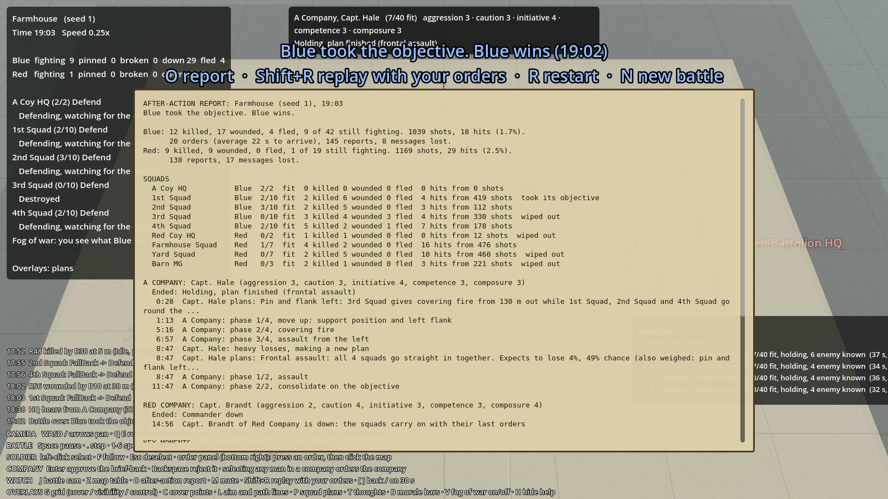

# Replays and the after-action report

## What it is
Milestone 6. Every battle can be **watched again** exactly as it happened, and when it ends you get an
**after-action report**: who won and why, the losses, what each squad did, each company commander's story, the key
moments and the best shots.

Code: `sim/GroundWar.Sim/Combat/Battle.Commands.cs` (recording and playing back), `sim/GroundWar.Sim/AfterActionReport.cs`
(the report), the report panel in `game/Hud.cs`, keys in `game/Main.cs`.

## Why
"Watch and replay battles the way a player would" is what the build plan asks of this milestone. Replays also help
playtesting: when something odd happens, you can go back 30 seconds and watch it again, and a bug report can be
"seed 4, these orders".

## How replays work
The simulation is **deterministic**: the same seed and the same inputs always give the same battle (see
[Architecture](architecture.md#determinism)). The only inputs are the player's, so a battle is just its seed plus a
list of **commands**: each order you sent, each brief-back you approved or rejected, and the tick it was done after
(`PlayerCommand`). Everything you do goes through `Battle.PlayerOrder`, `PlayerApprove` and `PlayerReject`, which
record it.

A replay is a new battle with the same seed and `LoadReplay(commands)`: each command is done again at the start of
the tick after the one it was recorded in, which is the same moment it happened the first time.

| Key | Does |
|---|---|
| **Shift+R** | Watch the battle again from the start, with your orders |
| **[** | Back 30 s: replays from the start and runs on (without drawing) to 30 s earlier. Takes a moment on a long battle |
| **]** | On 30 s (runs the battle on without drawing) |
| **R** | Restart the same battle **without** your orders (as before) |
| **N** | A new battle (new seed) |

While a replay still has orders to play, the status panel shows **REPLAY**. If you give an order (or answer a
brief-back) during a replay, you **take over**: the rest of the recording is dropped and the battle goes your way
from there.

## The after-action report
Shown when the battle ends (**O** opens or closes it at any time, even mid-battle). Built by
`AfterActionReport.Build(battle)`; the runner prints it with `--report`. It has:
- **The result** and its reason.
- **Each side**: killed, wounded, fled, still fighting; shots and hits; tanks lost; orders sent and how long they took on
  average, reports sent, messages lost.
- **Squads**: fit men left, losses, hits, and whether it took its objective, broke or was wiped out.
- **Each company**: the commander and his traits, how he ended, and his story: the plans he made, each phase, re-plans,
  refusals, fire shifted onto machine guns.
- **Key moments**: the first shots, the first casualty on each side, plans, refusals, squads breaking, objectives
  taken, commanders down, tanks knocked out, the end. These come from log lines marked as key (`LogKind.Key`).
- **Best shots**: the three men on each side with the most hits.

## Tests
`ReplayTests.cs`: the same seed and commands give exactly the same battle (every man in the same place); without the
commands it's a different battle; the report's numbers add up, its timeline is in order and has the first shots and
the end, and the company story has the commander's plan.
