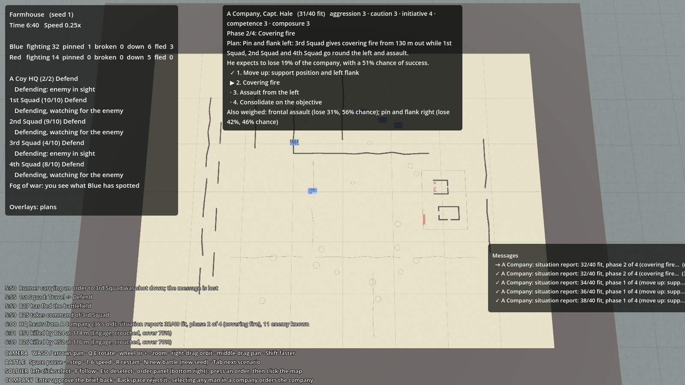
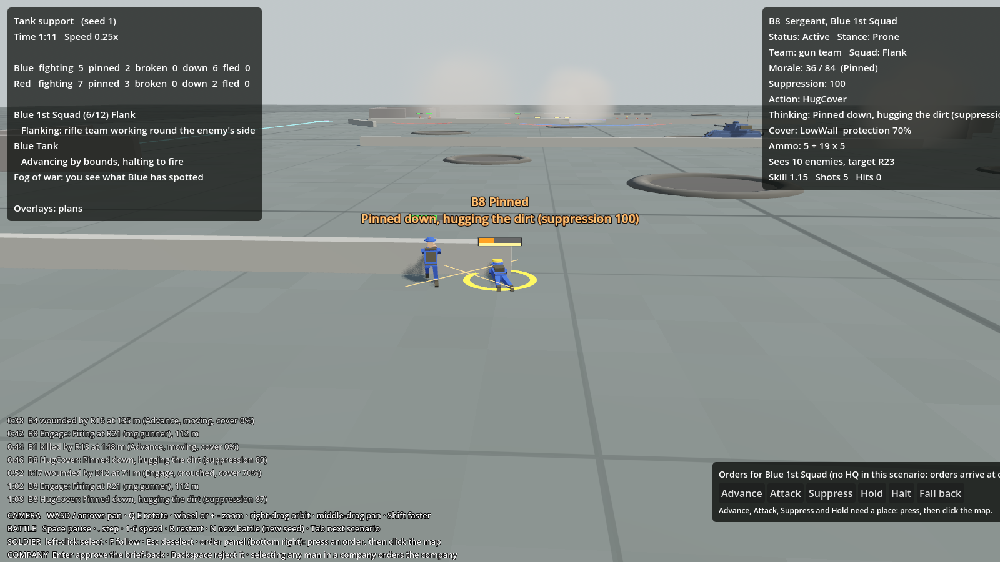

# Spectacle: map table, battle cam, slow motion, smoke and sound

## What it is
Milestone 6, the "watch it like a player" pass. The fun of Ground War is watching believable AI fight, so this
milestone is about seeing and hearing it well:

| Feature | Key | Code |
|---|---|---|
| **War-room map table**: zoom far out and the battlefield fades into a paper map on the commander's table | Z (or just zoom out) | `game/TableView.cs` |
| **Battle cam**: the camera finds the fiercest fighting your men are in and follows one of them | J | `game/ActionCamera.cs`, `Main.UpdateActionCam` |
| **Slow motion**: with the battle cam on, a man hit close to the one you're following slows time to ¼ for a moment | (automatic) | `Main._slowmoUntil` |
| **Follow cam**: follow the selected man | F | `game/CameraRig.cs` |
| **Lingering smoke** from shell and bazooka bursts, and burning wrecks | | `game/SmokeView.cs`, `game/shaders/smoke.gdshader` |
| **Sound**: shots, tank guns, bursts, a radio squelch, distant rumble | M mutes | `game/SoundView.cs`, `sounds/`, `tools/make_sounds.py` |
| **Replays and the after-action report** | Shift+R, [ ], O | see [Replays and reports](replays-and-reports.md) |

Tracers and the quick muzzle and dust puffs were already there (`game/BattleView.cs`).

## Why
The design's pillar is that the spectacle is the fun. A player should be able to sit back and watch a battle the
way you'd watch a film: from the planning table down to one man in a ditch.

## The map table
- Fades in as the camera pulls back past 260 m from what it's looking at, fully there at 360 m
  (`TableView.FadeStart`, `FadeEnd`). Zoom back in and it fades away. **Z** flies straight up to it, and again back down.
- The paper is drawn once at the start from the map: a 50 m grid, high walls and tall hedges in dark ink, low walls
  and hedges in green, shell holes as rings, woods as green patches, crops in straw, and a brown form line
  for every 2 m of height.
- **Counters**: a blue wooden block for each of your squads (and company HQs) with its name and how many men are fit.
  They sit where the squad is now (your own troops are always shown live).
- **The enemy**: red pencil crosses where battalion HQ believes the enemy is, from reports. With fog of war off (V) the
  enemy gets red counters instead.
- The company commanders' plan arrows show on top of the table, so a brief-back can be read like a map exercise.

## The battle cam (J)
Every shot fired and where it landed is remembered for 5 s. The camera picks the man with the most of that within
25 m of him (with fog of war on, only your own men, so it never shows you an enemy you haven't found), flies down
behind him at a low angle (16–30 m away, a little to one side) and follows him. After about 9 s, or if he falls, it
moves on. If anyone is hit within 30 m of him, the battle runs at ¼ speed for 2.5 s. J again turns it off.

## Smoke
- **Bursts** (tank shells and bazooka rockets) leave seven puffs of dirty grey smoke that billow up, drift downwind
  (`SmokeView.Wind`) and fade over 20–30 s.
- **Knocked-out tanks** burn: a column of black smoke and a flickering orange light for the rest of the battle.
- The smoke from bursts and burning wrecks is only for show: it does not block sight. **Smoke screens** from mortar
  smoke rounds (milestone 7) do: they are clouds in the simulation, drawn here as heaps of big white puffs as wide
  and thick as the simulation says. See [Battalion support](support-fire.md).

## Sound
- Placeholder sounds made from noise by `tools/make_sounds.py`: `rifle`, `mg`, `tank_gun`, `explosion`, `radio`,
  `distant` (a loop). **To use real recordings**, save WAV files with the same names in `sounds/`.
- Shots are placed in 3D where they're fired, so they're louder close to the camera. In a big firefight only the 3
  nearest small-arms shots each tick are played (1 at 2× speed or more, none above 4×) so it's a roar, not a wall of
  noise. Tank guns, bazookas and bursts always play.
- The distant rumble swells with the amount of shooting in the last few seconds.
- A radio squelch plays when a report or brief-back reaches your battalion HQ.
- **M** mutes everything.

## Tests and checks
This is drawing and sound, so it's checked with screenshots rather than unit tests. The screenshot mode has
`--overlays=j` (battle cam on) and `--overlays=r` (show the report), and `--camera` with a large distance shows the
table. See [Testing and tuning](../tools/testing.md).

## Not done yet
- Smoke that blocks sight (smoke shells, smoke grenades).
- Real recorded sounds, and sounds for men shouting, tank engines and tracks.
- The table's counters are blocks with names; proper NATO-style symbols are an art job for later.
