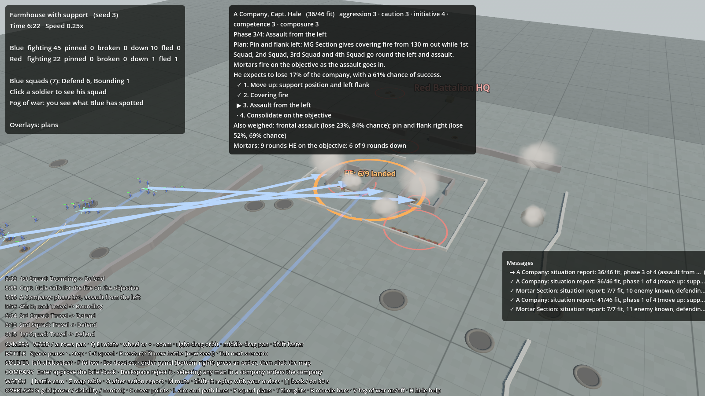
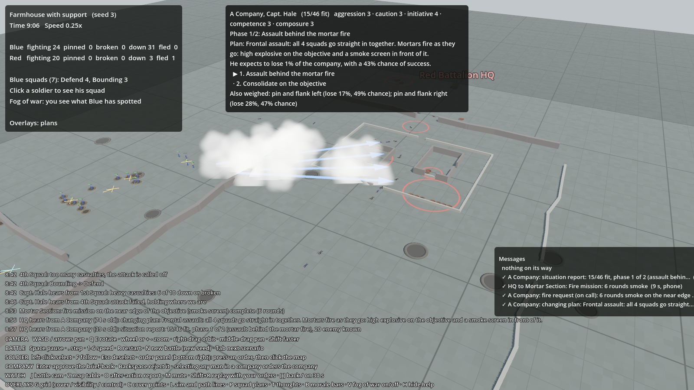

# Battalion support: mortars, smoke and MG sections

## What it is
Milestone 7, part 1. The battalion's own weapons, which you hand out to the companies:

- **Mortar sections**: a few tubes behind the lines with a stock of high explosive (HE) and smoke rounds. They fire
  on a spot when they're told to: by you, or by a company commander who asked battalion for it.
- **Smoke screens**: a smoke round makes a cloud that **blocks sight** (not bullets) for about a minute, drifting
  with the wind. Men behind it can't be seen, so they can't be aimed at.
- **MG sections**: two heavy machine guns on tripods. You **attach** one to a company and the company commander
  uses it like one of his squads (it is the obvious squad to give covering fire).

Code:
- `sim/GroundWar.Sim/Combat/Battle.Support.cs`: fire missions, the mortars at work, where rounds land, attaching.
- `sim/GroundWar.Sim/Map/BattleMap.cs`: smoke clouds and how they block sight (`SightBlocked`, `WallBlocked`, `AddSmoke`, `UpdateSmoke`).
- `sim/GroundWar.Sim/AI/CompanyCommander.cs`: when a commander asks for fire (search for "mortar fire").
- `sim/GroundWar.Sim/Comms/Messages.cs`: `FireMission`, `FireKind`, and the new order and message kinds.
- `game/SupportView.cs` draws the mortar tubes and target rings, `game/SmokeView.cs` the smoke screens, and
  `game/BattleView.cs` the bursts. The order panel buttons are in `game/Hud.cs`.



*Captain Hale's on-call HE landing on the farmhouse as his squads assault from the left (orange ring: 6 of 9 rounds down).*



*Later in the same battle: his smoke screen between the farm and his squads for a frontal assault.*

## Why
The design's story of a battle has Captain Reyes, pinned by a hidden machine gun, radioing *"Request smoke on the barn,
over."* Indirect fire is what a WW2 company commander leans on when an attack stalls, and asking for it has to cost
time, like every message. The rounds take time to arrive, so they land where the enemy *was*. Smoke makes the
"pin and assault" drill possible against a gun you can't knock out. The battalion's heavy weapons are the
"battalion assets" you assign to companies.

## A fire mission, start to finish

| Step | What happens | Time |
|---|---|---|
| 1. Request | The commander sends "fire request: 9 rounds HE on the machine gun at the objective" up to battalion, by the best way he has (usually radio) | Battalion radio: about 30 s |
| 2. Battalion passes it on | Battalion picks a mortar section in range with that kind of round and the shortest queue, and sends it the fire mission (the scenario lays a telephone line to the mortars) | Telephone: about 10 s |
| 3. Laying the tubes | The crew lay the mortars on the new target | 12 s (`support.setUpTime`) |
| 4. Firing | Every tube fires a round every 5 s until the rounds asked for are gone | (`support.roundInterval`) |
| 5. Flight | Each round flies for 8 s plus 1 s per 150 m | (`support.flightTime`, `flightSpeed`) |

So from asking to the first burst is usually a minute or more. Your own fire missions skip step 1.

**On-call targets.** A minute is far too slow for fire that has to land just as an assault goes in, so a commander's
*planned* fire is booked ahead: when his plan starts, he sends the targets up as **on call**. They go through steps
1 to 3 while his squads move up, and the mortars wait, laid on the target. When the assault starts he **calls** for
it on the radio, straight to the mortars (battalion already has the details): that takes about 10 s (the company
radio delay), or a runner's time without a radio. The first rounds land 20 to 30 s after the call. If the plan
changes or ends before he calls, he cancels the target and the mortars stand down from it. A section laid on an
on-call target that someone else needs right now fires the urgent mission first, then lays on again.

**Where rounds land.** Each round lands at the target plus a random miss (bell-curve, 30 m either way for the first
rounds: `support.firstSpread`). Once every tube has fired once, if anyone on that side can see the target area,
the fall of shot has been corrected and later rounds close in to 14 m (`support.adjustedSpread`). Smoke rounds
scatter less (60%).

**HE** bursts like a tank shell (`mortar_he` in `weapons.json`: blast radius 9 m, suppression to 30 m), friend or foe.
Men seen to fall are struck off the requesting commander's and battalion's picture of the enemy, because they were
watching.

**Smoke** makes a cloud 14 m across (`support.smokeRadius`) that builds up over 6 s, lasts 75 s, drifts with the
wind (`support.wind`, metres a second) and thins out at the end. A line of sight through the thick middle of a
cloud (80% of its radius) is blocked. Two men 12 m apart or closer still see each other.

**Crews.** It takes two men to work a tube (`support.crewPerTube`); a crew hugging the ground under fire doesn't
work them. When too few men are left to work even one tube, the section's missions are dropped. Ammunition is
counted: when a kind runs out, missions of that kind are refused.

## When a company commander asks for fire
Only if his side has a mortar section with the right rounds. He never asks for HE within 60 m of his own men
(`support.dangerClose`), and doesn't ask for the same place twice within 90 s (`support.requestCooldown`).

| When | What he asks for | Who |
|---|---|---|
| **Planning an attack** | On-call HE on the objective (on the nearest known machine gun there, if any), called as the assault goes in. In a frontal assault, also an on-call smoke screen on the near edge of the objective. | HE: caution 3 or more, or machine guns known there; a bold, careless man (aggression 4+, caution 2 or less) skips it if no guns are known. Smoke: caution 3 or more, or machine guns known |
| **A squad is pinned by a machine gun** | 4 rounds on that gun: smoke if he is a careful man (caution 3+), otherwise HE | Initiative 3 or more |
| **Refusing an attack** | 9 rounds HE on the worst machine gun (or the objective). When it has landed he thinks again, and if the plan no longer looks like a death trap he makes it (you get a new brief-back) | Initiative 3 or more to think again; at most twice per order |
| **Holding or defending** | 4 rounds HE on a group of enemy infantry seen coming, within 350 m | A group of 4 or more seen together; 2 for a very cautious man, 6 for a careless one |

**In the plan.** The fire is called as the assault phase starts, in both a frontal assault and pin and flank: the
bombs fall while the squads cross the open ground and lift as they close in, and the smoke builds up between them
and the defenders. (A first version fired the HE *before* the assault and waited for it to finish. The defenders'
fear wore off in the seconds it took the squads to get going, so it did almost nothing. That's why it's on call.)
Just before calling it, he checks again that none of his own men are within 60 m of an HE target; if they are, he
cancels it. In his estimates, HE knocks 40% off the fire of known enemies within 50 m of where it lands; smoke takes
55% off the fire of enemies near the smoke; the defence counts for 20% less with HE and 15% less behind smoke; and
the assault takes 15 s longer (the call and the first rounds).

## Your orders
Select a man of a mortar section: the order panel shows **Fire HE** and **Fire smoke** (with the rounds left). Press
one and click the target. The mission goes to the mortars like any order (with delay) and fires 9 rounds of HE or 6
of smoke. A ring on the ground shows each fire mission of your side, orange for HE and white for smoke, with how many
rounds have landed.

Select a man of an MG section that isn't with a company: **Attach to a company**, then click any man of the company
it is to join. When the order arrives, the section joins the company and moves to just behind the company HQ; the
commander uses it from his next plan. Once attached, selecting its men orders the company (like any of its squads);
**Back to battalion** takes it out again.

The company panel lists the commander's fire requests and how far along each one is. The after-action report counts
each side's fire missions and rounds.

## Setting it up (scenario file)
```json
{ "name": "Mortar Section", "order": "Hold", "objective": [12, 116], "facing": [1, 0],
  "spawnCenter": [12, 116], "spawnSize": [6, 8], "weapons": { "rifle": 7 },
  "mortars": 3, "mortarHe": 60, "mortarSmoke": 24 },
{ "name": "MG Section", "order": "Hold", "objective": [20, 186], "facing": [1, 0], "asset": true,
  "spawnCenter": [20, 186], "spawnSize": [6, 8], "weapons": { "rifle": 4, "hmg": 2 } }
```
A group with `mortars` is a mortar section (its men are the crew and carry rifles). `asset: true` makes a group a
battalion asset you can attach. Scheduled orders can attach (`"order": "Attach", "attachTo": "A Company"`) or fire
(`"order": "FireMission", "objective": [x, y], "fire": "Smoke", "rounds": 6`). Lay a phone line to the mortars so
fire missions reach them quickly.

The scenario **Farmhouse with support** (`scenarios/farmhouse_support.json`, Tab to it in the game) is the
farmhouse attack with a Blue mortar section (3 tubes), an MG section that battalion attaches to A Company at the
start, and a Red mortar section (2 tubes, HE only).

## Tuning
`data/rules.json` → `support` (every number above). `data/weapons.json` → `mortar_he` (blast and fear) and `hmg`.

## Tests
`SupportTests.cs`: smoke blocks sight but not bullets, lets men close together see each other, and clears; smoke
drifts with the wind; a battalion fire mission takes time and lands around the target; the commander plans on-call
mortar fire and battalion passes his request to the mortars; an on-call target is laid on and waits for the word,
then lands quickly; a cancelled target is never fired; an attached MG section becomes one of the
company's squads; defenders call fire on attackers they see; with no mortars, nobody asks; a section runs out of
smoke and can't fire it any more.

## Results
Runner, 200 battles each, seeds 1 to 200:

| Scenario | Blue | Red | Draws |
|---|---|---|---|
| Farmhouse, no support | 94 | 89 | 17 |
| Farmhouse with support (both sides) | 99 | 77 | 24 |

With support on both sides the attack does a little better and battles are a bit shorter (963 s against 1014 s on
average). In 120-battle checks, Blue's support alone took Blue from 57 to 64 wins, and Red's mortars alone took Red
from 53 to 72: defensive fire on infantry crossing open ground is the stronger use, which is what you'd expect.
The full runner table is in [Testing and tuning](../tools/testing.md).

## Not done yet
- Artillery (bigger guns from off the map) works the same way and will be added with the battalion battle.
- Fire requests from your commanders are passed on automatically. You can't yet turn one down or change who has
  priority.
- Mortar sections stay where they start. Tubes and crews can be hit, but there is no counter-battery fire.
- The enemy battalion commander (milestone 7, part 2) will use the mortars for its own plans.
