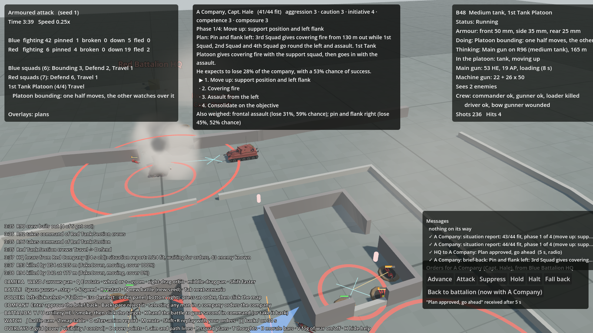
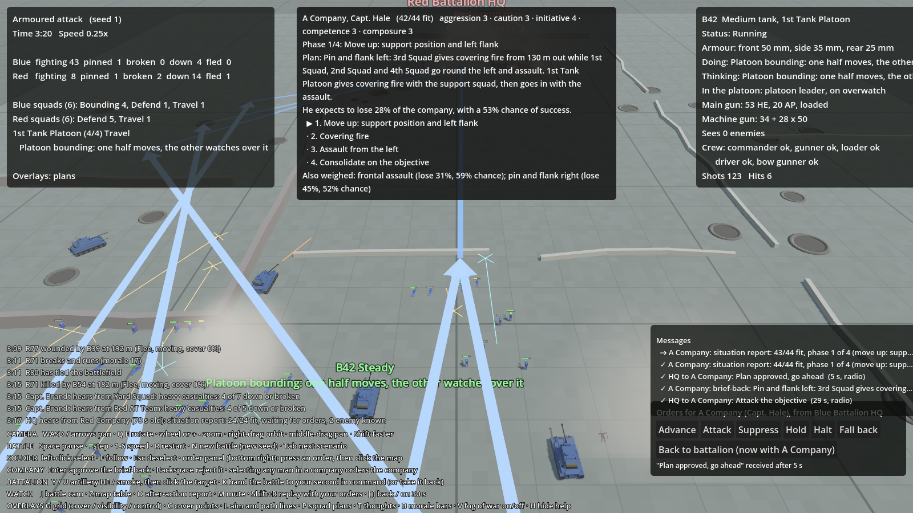

# Tanks

## What it is
One medium tank type: a hull that drives and turns, a turret with a main gun (high-explosive shells and, since
milestone 8, armour-piercing shot), a machine gun, armour, a crew of five, and a tank commander AI that is separate
from the squad and soldier AI. Tanks fight in **platoons** of 3 to 5 under a platoon leader, and a company commander
who has tanks attached gives them a part in his plan (milestone 8).
Design: the Tanks design doc. Code: `sim/GroundWar.Sim/AI/TankBrain.cs` (tank commander and platoon leader),
`Combat/Battle.Tanks.cs` (moving, guns, armour), `Combat/Battle.Crews.cs` (crews), `Data/VehicleDef.cs`;
drawing in `game/TankView.cs`.

## How a tank is put together
In the simulation a tank is a `Soldier` with a `Vehicle` set (`IsTank`). This lets it reuse spotting, the knowledge
system and the machine gun, while its own rules take over for moving, the main gun, morale and damage. A tank
is in a vehicle group of its own (`Group.IsVehicles`), which skips the squad brain. Scenarios add tanks with
`"vehicles": { "tank": 1 }` on a group.

Tuning: `data/vehicles.json` (speed, turn rates, armour, which guns, damage chances, how easy it is to spot and hit,
stand-off distance) and the `tank_gun`, `tank_mg`, `atr` and `bazooka` entries in `data/weapons.json`.

## Moving
The hull turns in place, then drives once it faces within about 30° of where it's going (`Battle.MoveTank`).
It uses a wider path-finding grid than men (`BattleMap.TankNav`), so it doesn't squeeze through gaps it can't fit.
An immobilised tank (broken track) can't move but still fights.

Tanks can't enter woods or cross hedgerows, and climb slopes more slowly (see [The ground](terrain.md)).

## Guns
- **Main gun** (`Battle.UpdateMainGun`, `FireShell`): the turret turns towards the target at its own rate. The gun
  fires when on target and loaded (7 s). A moving tank first stops for a short halt (about 4 s) to fire.
  Shells land close to the aim point, scattered short or to the side.
- **Blast** (`Battle.Blast`): men within 6 m (`blastRadius`) may be hit, more likely the closer they are, half as likely
  lying down, and less behind cover. Everyone within 14 m gets heavy suppression, friends included.
- **Machine gun**: works like an infantry machine gun, and can fire on the move without turning the hull.
- Shells and the machine gun give the tank away to men near where they land.

## Armour and damage (`Battle.ArmourHit`)
Rifles and machine guns can't hurt a tank. Armour is 50 mm front, 35 side, 25 rear; the side that's hit depends on
the angle from the shooter to the tank's facing. A weapon's `penetration` falls to half at its full range.

| Weapon | Penetration | Against the medium tank |
|---|---|---|
| Rifle, machine gun | 0 | Rings off |
| Anti-tank rifle | 22 mm | Never gets through; 15% chance to break a track (`trackBreakChance`) |
| Bazooka | 100 mm | Through any side within ~100 m; range 150 m; one rocket at a time, slow to reload |
| Tank main gun, high explosive | 50 mm | Side and rear; front only point-blank |
| Tank main gun, armour-piercing | 85 mm | Front out to about 800 m, side and rear at any range (no blast) |

When a hit gets through: 45% knocked out (it becomes a dark wreck and the crew bail out, see below), 30%
immobilised (and an even chance one of the crew is hit), otherwise the shot goes into the crew compartment: one man
is hit (35% chance two), and the gun is 4 s slower while they sort themselves out. A round that doesn't get through
can still break a track (10% unless the weapon says otherwise).

**Which round:** a tank fires armour-piercing at enemy tanks while it has any (20 rounds, `apRounds` in
`vehicles.json`, weapon `tank_gun_ap`), and high explosive at everything else (60 rounds). AP is flatter and more
accurate than HE but has no blast.

**Bazooka backblast:** firing one throws flame and smoke out behind, so every enemy near the target learns exactly where
it came from. A bazooka gunner never fires at infantry.

**Why these numbers:** the Tanks design doc says anti-tank rifles only trouble light tanks and break tracks, and that
bazookas, satchel charges, mines and AT guns are the real tank killers. Grenade bundles, satchels and mines come with
tank hunting in M8.

## The crew (`Battle.Crews.cs`)
Each tank carries five real soldiers: **commander, gunner, loader, driver, bow gunner** (`Soldier.CrewRole`). They
ride inside (`SoldierStatus.Mounted`), aren't drawn, can't be seen or shot, and take no part until they get out.
They belong to a group of their own per platoon ("1st Tank Platoon crews", `Group.IsCrew`) that sleeps until someone
bails out; it never reports to HQ and doesn't count towards a squad breaking.

Every man lost makes the tank fight worse (`GunCrew`, `DriveFactor`, `LookoutFactor`):

| Lost | Effect |
|---|---|
| Loader | The gunner loads for himself: 1.8× as long between shots |
| Gunner | The loader moves to the gun: aims at 75%, 1.6× loading time |
| Gunner and loader | The commander works the gun alone: 60% aim, 2.2× loading |
| Gunner, loader and commander | The gun is silent |
| Driver | The bow gunner drives, at 70% speed |
| Driver and bow gunner | The tank can't move (and counts as stuck) |
| Commander | Buttoned up, half as likely to spot anything |

**Bailing out.** The crew get out when the tank is knocked out (it brews up: each man inside has an even chance of
not making it), or **abandon** it, which counts as the tank lost, when three or more of them are down or both the
commander and gunner are. A crew in a tank that can't move, with enemy infantry within 35 m and none of their own
near, may also abandon it (6% each time the commander thinks). The men who get out come out shaken and pinned, and
their group gets a leader and makes its way back on foot to where the platoon started. Men killed or wounded inside
stay inside (`Soldier.InTank`).

**Why:** the Tanks design doc asks for crew AI: a tank is five men, not a hit-point bar. A crew that loses its
gunner, or its commander's eyes, is a weaker tank, and crews running from a burning tank are part of the spectacle.

## The platoon (`TankBrain.ThinkPlatoon`)
A vehicle group with two or more tanks is a platoon. Every 2 s its leader (the first tank; if it's lost, the next
tank commander takes over) decides where each tank should be (`Soldier.PlatoonGoal`):
- **Travelling** with no enemy known: a **wedge** behind the leader, 30 m between tanks.
- **Enemy known**: **bounding overwatch**. Half the platoon (the leader's half first) drives a 45 m bound while the
  other half halts and watches over it (`Soldier.Overwatch`), then they swap. A bound that takes over 40 s is
  given up and the halves swap anyway.
- **Arrived** (or holding, or giving covering fire): a **line** across the objective, 30 m apart, every tank free to
  fight.
- **Pulling back**: once half the platoon is knocked out or stuck during an attack, the leader pulls the rest back
  120 m and holds, and reports the attack failed.

Each tank's own commander still picks targets, keeps his front to the danger and halts to fire; the platoon leader
only says where to go. Tanks of a platoon spread their fire: a tank scores a target a platoon mate is already
firing at at half (enemy tanks excepted, which everyone fires at).

## Tanks in the company plan (`CompanyCommander.AddTanks`)
A battalion can attach a tank platoon to a company (like an MG section). The company commander then gives it a part
in each plan he weighs, and counts it in the plan's odds (the enemy's fire on his men is cut by 30% a tank, down to
half):
- **Pin and flank**: the tanks move up to the support squad's position, give covering fire with it, and go in with
  the assault ("1st Tank Platoon gives covering fire with the support squad, then goes in with the assault").
- **Frontal assault**: they move up to the start line and lead the assault.
- **Defend**: they sit 40 m behind the line. **Advance**: they go with the squads. **Covering fire**: they join it.
- In every attack, once the objective is taken, they hold just short of it.

If the tanks arrive after he has made his plan (the attach order goes by radio and can take a minute), he gives
them their part in the plan he's running and sends them their orders for the phase it's in. If he had refused the
attack as a death trap, the tanks are the support he asked for, and he thinks again.
- **Advances by bounds**: drives about 40 m, halts briefly to fire, moves on.
- **Main gun targets**: enemy tanks first, then anti-tank weapons and machine guns, then bunches of men (more men
  close together score higher, broken men less).
- **Machine gun targets**: the nearest dangerous man, anti-tank gunners first.
- **Keeps its front armour towards known anti-tank threats** while it fights.
- **Won't charge infantry alone**: if enemy infantry is within 45 m (`standOff`) and none of its own infantry is within
  30 m, it holds back and says so ("Holding back: enemy infantry close and no infantry of our own with us").
- Status and thought show in the HUD like a squad's.

## Effect on infantry
An enemy tank within 100 m drains the morale of men who have nothing that can hurt it (0.3 a second, half that in
good cover; `morale.tankFearPerSecond`, `tankFearRange`). Losing a tank costs nearby friends morale; knocking one out
lifts the side that did it.

## Seeing it in the game
Click the tank: the right panel shows armour, whether it's running, immobilised or knocked out, its part in the
platoon (leader, on overwatch, moving up), HE and AP rounds left and loading, the state of each of its crew, and what
the commander is thinking. Crews who bail out appear on the ground next to the tank and show in the group list.
Tab to **Tank platoons** for the milestone 8 battle. Shells show as a bright tracer with a flash and a burst of smoke.

## Results
**"Tank support"** (200 battles): Blue wins 168, Red 32 (without the tank, the same attack wins 31). The tank was
knocked out in 34 battles and immobilised but still fighting in 15. (Before the crews, 171 to 29.)

**"Tank platoons"** (milestone 8, 200 battles): **Blue 124, Red 74, 2 draws**. The same farmhouse attack without
tanks is about even (94 to 99). Of 1,200 tanks that fought, 772 were knocked out or abandoned and 105 more
immobilised. Most battles see a tank duel: Blue's platoon trading AP shot with Red's two tanks behind the farm, then
the bazooka team on the flank. The runner prints this tank summary for any scenario with tanks.

Getting there: with two Red tanks and two bazookas Blue won 72 of 100; with three Red tanks Blue won only 20 (the
platoon lost the duel and pulled back). The final version keeps two Red tanks and gives the bazooka team a third
bazooka. Two problems found in the logs and fixed on the way: the crews' group counted the men still inside as
"down", so it reported heavy losses and broke while nobody had got out; and tanks that joined the company after
Captain Hale had planned sat idle, so he now fits late arrivals into his plan. In some battles a company that
refused the attack was never sent in again, which used to be a draw and now counts as the defender holding (see
[Who wins](battle-results.md)).

*Seed 1, 3:40 in: Blue's B48 (selected, panel on the right: its loader killed and bow gunner wounded earlier by
Red's tank) has just knocked out R90, which brews up behind the farm; its crew bail out and Red's other tank
takes over the section.*

*Twenty seconds earlier: the platoon leader (B42, selected) on overwatch while the other half of the platoon
bounds up past the support squad.*

## Tests
`TankTests.cs`: rifles can't get through, the anti-tank rifle only breaks tracks, the bazooka gets through the side;
the tank drives towards its objective; only anti-tank weapons knock it out, and its main gun kills men.

`TankPlatoonTests.cs` (milestone 8): every tank has a crew of five riding inside, who don't report or break; each
man lost makes the tank worse (loader, gunner, driver, commander); with three men down the crew abandon the tank and
the rest bail out, shaken, under a new leader; AP gets through a front that HE can't; attached tanks get a part in
the company's attack plan; tanks that arrive after the plan is made are fitted into it; the platoon bounds half at a
time with the rest on overwatch; a stuck tank with enemy infantry close (and none of its own) may be abandoned.

## Not done yet
- Escorting infantry riding on the tanks, and infantry tank hunting (grenade bundles, satchel charges, mines).
- Damage by parts (turret jammed, gun damaged, engine fire) beyond tracks and crew.
- Bailed-out crews only make their way back: they don't yet get back into a tank or join the infantry.
- Battalion commanders don't yet attach tanks themselves: the scenario does.
