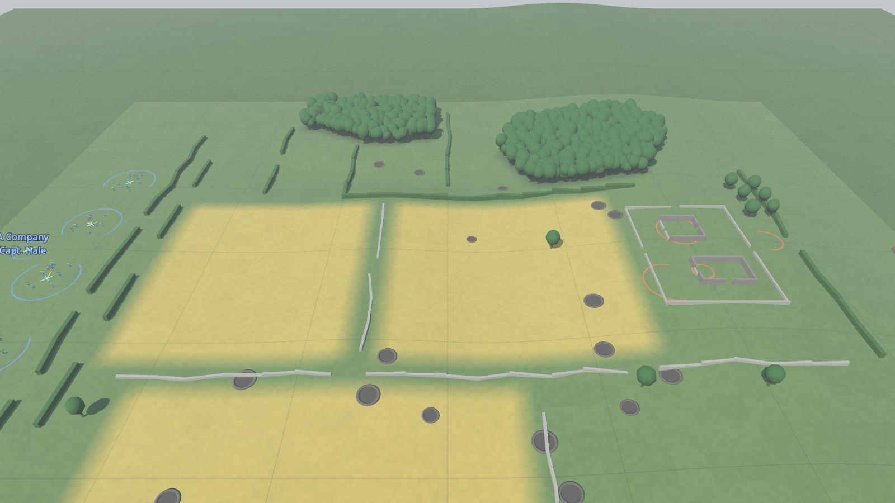
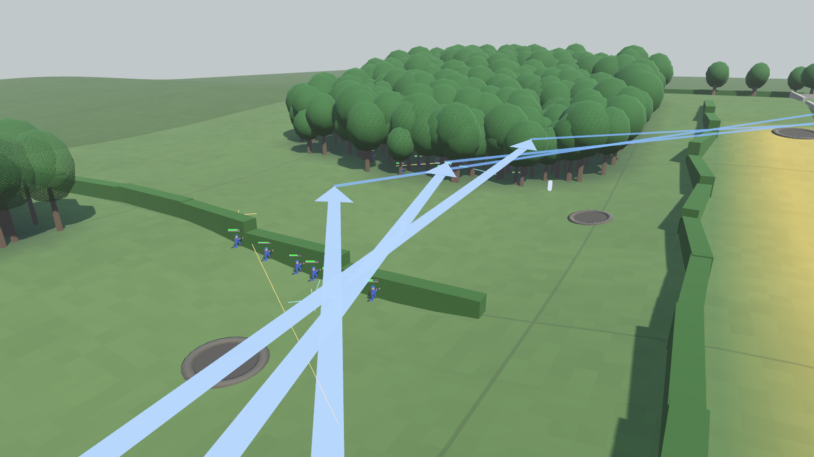
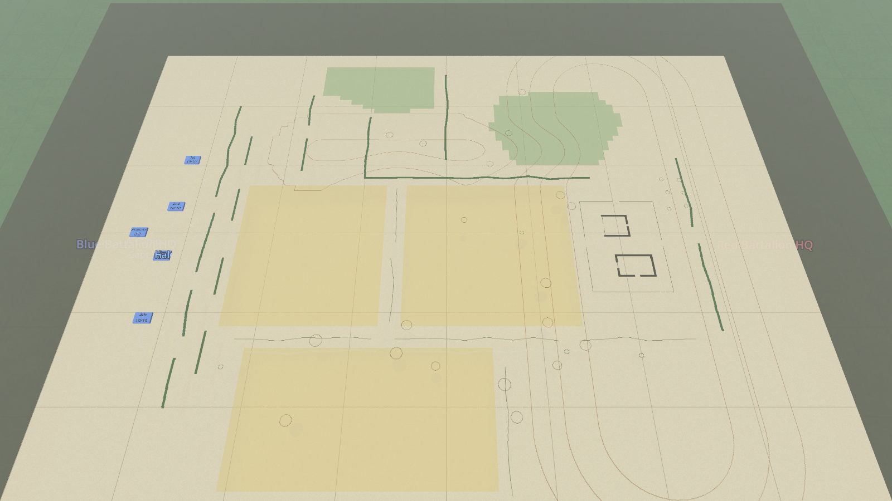

# The ground: hills, woods, hedgerows and crops

## What it is
The shape of the battlefield and what grows on it. Until this was built every map was dead flat and the only
cover was walls and shell holes, so the AI had nothing to "read". Now a map can have:

| Feature | Hides you? | Stops bullets? | Slows you? | Notes |
|---|---|---|---|---|
| **Hills, ridges, hollows** | Yes: a crest hides everything behind it | Yes | Uphill only | The basis of "dead ground": places the enemy can't see or hit |
| **Woods** | Yes, after about 30 m of trees | No | A little | Some protection everywhere, good protection right behind a trunk. Tanks can't enter |
| **Hedgerows** | Yes, unless you or the man you're looking at is right up against it | No | A lot (pushing through) | Some protection (it grows on an earth bank). Tanks can't cross |
| **Standing crops (wheat)** | Only if you keep low | No | Slightly | A man flat on his face is nearly invisible, and nearly blind |



This is step 1 of the core AI rework (November 2026). Jimmy's call: the ground comes first, because every
other AI fix (morale, squad drill, commanders' plans) depends on there being ground worth using.

## Why it was built this way
- **One grid, built once.** `Terrain` cuts the map into 4 m squares and stores a height for every corner and
  what grows in every square. Asking "how high is the ground here?" or "is this wood?" is then a table look-up,
  which matters because sight lines are checked many thousands of times a second.
- **Maps describe shapes, not numbers.** A map file says "a ridge from here to there, 8 m high, 95 m wide" or
  "a wood with this outline". You (or a map script) never type in a grid of heights.
- **Flat maps cost nothing.** A map with no hills or woods skips all the new sums, so the old test maps and the
  1,000-a-side stress test run exactly as before (checked: still about 9 to 11 times real time).
- **The sim and the picture share one list of trees.** The trees you see are the trees soldiers hide behind.
  Their places are worked out from the map alone (no dice), so a replay finds every tree where it was.

## Map files
In `data/maps/*.json`, next to `walls` and `craters`:

```jsonc
"ridges": [ { "a": [305, 40], "b": [305, 260], "width": 95, "height": 8 } ],   // negative height = a valley
"hills":  [ { "center": [40, 150], "radius": 70, "height": 1.5 } ],            // negative height = a hollow
"areas":  [ { "kind": "woods", "points": [[236,40],[300,34],[318,62],[296,98],[244,100],[228,70]] },
            { "kind": "crops", "points": [[82,118],[166,118],[166,210],[82,210]] } ],
"trees":  [ [262, 222], [300, 224] ],                                          // single trees outside the woods
"walls":  [ { "a": [150,110], "b": [162,111], "thickness": 1.6, "hedge": true } ]
```

- A hill or ridge is a smooth mound: full height in the middle, fading to nothing at `radius` / `width`.
  Where several overlap, their heights add up.
- An area is an outline (any number of corner points). Woods get one or two trees per 4 m square.
- A wall with `"hedge": true` is a hedgerow. (`"high": true` walls are still masonry: they block sight and bullets.)

The farmhouse and valley maps are made by `tools/make_farm_map.py` and `tools/make_valley_map.py`: edit the
script and run it, don't edit the JSON.

## How it works
Code: `sim/GroundWar.Sim/Map/Terrain.cs` (heights, woods, crops, trees) and `Map/BattleMap.cs` (hedgerows, and
the questions everyone else asks).

### Seeing: `BattleMap.SightBlocked(a, b)`
True if b is hidden from a. Checked in this order:
1. a smoke screen (as before);
2. a high wall (as before);
3. **a hedgerow** crossing the line, unless a or b is within 2.5 m of it (`hedgePeerDistance`): a man lining a
   hedge looks through the leaves, and can be seen through them;
4. **the ground**: the line is walked in 4 m steps from one man's eyes (1.5 m up) to the other's; if the ground
   rises above the line anywhere, it's blocked;
5. **woods**: the same walk adds up how many metres of the line pass through woodland below treetop height
   (`treeHeight`, 8 m). More than 30 m (`woodsSightDepth`) and it's blocked. So a man at the edge of a wood sees
   out and can be seen; a man 40 m inside can't; two men close together inside see each other; and a man on a
   hill looks over the top of a wood in the valley.

### Shooting: `BattleMap.WallBlocked(a, b)` and `ProtectionAt(position, from)`
- Only masonry and **the ground itself** stop a bullet or a shell blast. Hedges, trees and smoke don't.
- Protection (0 = in the open, 1 = can't be hit), on top of the walls, craters and foxholes from before:

| Situation | Protection | Tuning (`rules.json` → `terrain`) |
|---|---|---|
| Behind a crest | 1.0 | |
| Close behind a hedgerow that the shot crosses | 0.4 | `hedgeProtection` |
| A tree trunk within 1.5 m, on the side the fire comes from | 0.6 | `treeProtection`, `treeCoverDistance` |
| Anywhere else in a wood | 0.2 | `woodsProtection` |
| In crops | 0 (they hide, they don't protect) | |

Every tree and every 2 m of hedgerow is also a **cover point** (press C: dark green = hedgerow, light green =
tree), so soldiers choose them the same way they choose a wall.

### Being spotted: `BattleMap.Concealment(position, stance)`
Multiplies the chance to spot a man (see [Spotting and shooting](spotting-and-shooting.md)):
woods × 0.5, at a hedgerow × 0.4, crouched in crops × 0.5, prone in crops × 0.2. A man who fires still gives
himself away (× 4 as before).

**The wheat trade-off.** A man lying flat in crops sees nothing further than 12 m (`cropsProneViewRange`). So in
crops a soldier who wants to fight goes up on one knee (easier to see and hit), and a pinned soldier who goes
flat is safe but out of the fight. Without this, attackers crawling through wheat were invisible and could
still shoot, which won them nearly every battle.

### Moving: `BattleMap.SpeedFactor(position, direction)`
Hedgerow × 0.3 while pushing through, woods × 0.8, crops × 0.9, and uphill the speed is divided by
1 + 3 × slope (`uphillSlowdown`): a 1-in-5 climb is 1.6 times slower. Downhill is normal speed. Tanks are slowed
by slopes too, and their path finding (`BattleMap.TankNav`) treats woods and hedgerows as solid.

### The battlefield grid
`BattleGrid` (the 5 m squares every AI layer reads) now has real ground heights, counts woods as cover (0.45)
and crops as a little (0.15), and its visibility score uses the new sight lines. Press G for the overlays.

## How the AI uses the ground
Most of the AI already asked "can he see me?" and "how much cover is there?", so it picked up crests, woods and
hedges without being told. Four things were added:

| Who | What | Where |
|---|---|---|
| Squad leader | When he knows where the enemy is, he prefers to end each bound **out of the enemy's sight** (behind a crest, wood or hedge), not just near cover | `SquadBrain.NextBound`, `squad.deadGroundBonus` |
| Company commander | Picks the **covering-fire position** for height as well as cover and a view of the objective | `CompanyCommander.SupportSpot`, `terrain.highGroundBonus` |
| Company commander | Forms the flanking squads up **where the defenders can't see them** if such a place exists near the objective | `CompanyCommander.AssemblySpot` |
| Company commander | In a defence, shifts each squad a few metres to ground with **cover, a view and height** | `CompanyCommander.DefenceSpot` |
| Soldier | Fights from one knee in crops (see the wheat trade-off) | `SoldierBrain.SetStationaryStance` |



## What you see
`game/MapView.cs`: on a map with terrain the grey test floor is replaced by a ground mesh (`BuildTerrain`:
green grass, straw-coloured wheat, dark woodland floor), trees (`BuildTrees`) and green hedgerows. Everything
drawn in the game goes through `Draw.To3`, which now adds the ground height, so men, tanks, tracers, smoke and
arrows sit on the hills. Treetops fade out as the camera comes close so you can watch the men under them. The
map table shows woods in green, crops in straw and a brown form line every 2 m of height.



## What it did to the battles
100 battles each, before and after (12 Nov 2026):

| Scenario | Before (Blue / Red / draw) | After |
|---|---|---|
| Farmhouse (company attack) | 94 / 99 / 7 of 200 | 80 / 18 / 2 |
| Farmhouse with support | 99 / 77 / 24 of 200 | 97 / 1 / 2 |
| Tank platoons | 124 / 74 / 2 of 200 | 85 / 14 / 1 |

The attacker now wins far more often, and loses fewer men doing it (farmhouse: about 17 of 42 instead of 25).
The reason is honest but one-sided: **the attacker's AI uses the ground and the defender's doesn't yet.** The
attackers form up unseen in the wood 40 m from the farm; the defenders sit where the scenario put them and
never post anyone to watch the wood. Giving the defending commander a brain is step 5 of the rework plan. Until
then, expect attacks on these maps to succeed more than they should.

## Known gaps
- Buildings are still four walls with gaps: men can't go upstairs or fight from windows as such.
- No streams, marsh or roads; no mud. Height gives no bonus to shooting, only to seeing.
- A man is "a point 1.5 m up" for sight lines whatever his stance, so lying down behind a slight rise doesn't hide him more.
- Tanks don't tilt on slopes in the picture, and never go hull-down on purpose.
- The fair-test maps (`meeting_field*`), the test range and the town are still flat.

## Tuning
`data/rules.json` → `terrain` (every number above) and `squad.deadGroundBonus`. Change a number, save, press R.

## Tests
`sim/GroundWar.Sim.Tests/TerrainTests.cs`: a flat map behaves as before; a crest hides and stops bullets; a
hollow is dead ground; woods hide after a few tens of metres but don't stop bullets; trees are in the same
places every time and give cover from the right side; a hedgerow hides unless you're up against it, slows
infantry and stops tanks; tanks keep out of woods; crops hide a man lying down; uphill is slower; the grid
knows height and woods; the farmhouse is on its ridge with the north lane out of its sight.
